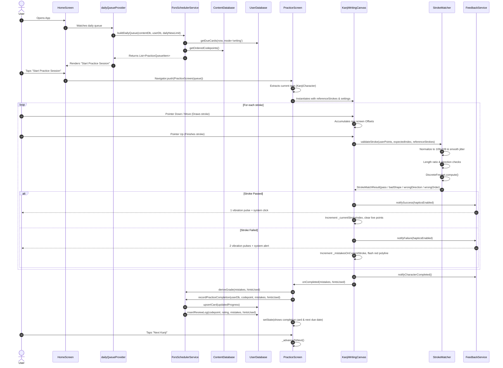
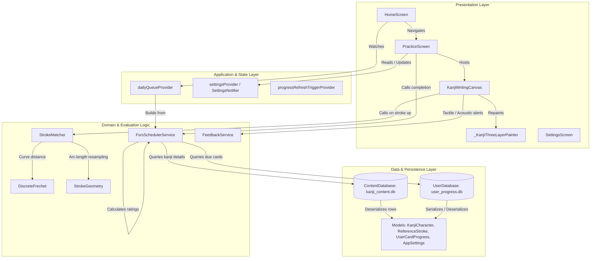

# Tsuzuri — Current Architecture Audit & Component Inventory

**Document Reference**: `CURRENT_ARCHITECTURE_AUDIT.md`  
**Application**: Tsuzuri (綴り) — Offline-first Japanese Kanji Learning Application  
**Module**: Practice & Learning System (Writing Module Baseline)  
**Date**: November 2026  
**Auditor**: Antigravity Technical Architecture Team  
**Scope**: Codebase audit of `d:\offline_kanji_practice_v1` across UI, canvas, matching engine, data persistence, and scheduling.

---

## 1. Executive Architecture Summary

An inspection of the repository reveals an application constructed on a clean foundation of local-first components, but with tight coupling between the presentation layer and the single implemented exercise modality (*Meaning → Write Kanji*).

| Attribute | Inspected State in Repository | Concrete Evidence / File Reference |
|---|---|---|
| **Flutter / Dart SDK** | Flutter 3.27+ / Dart SDK `>=3.3.0 <4.0.0` | [`pubspec.yaml#L9-L10`](file:///d:/offline_kanji_practice_v1/pubspec.yaml#L9-L10) |
| **State Management** | Riverpod 2.6 (`flutter_riverpod: ^2.6.1`) using `Provider`, `StateNotifierProvider`, and `StateProvider` | [`lib/src/providers/app_providers.dart`](file:///d:/offline_kanji_practice_v1/lib/src/providers/app_providers.dart) |
| **Database Implementation** | Direct SQLite C-bindings via package `sqlite3: ^2.5.0` and `sqlite3_flutter_libs: ^0.5.28`. *Note*: `drift: ^2.22.1` is declared in `pubspec.yaml`, but the current active implementation uses raw `sqlite3` driver APIs. | [`lib/src/data/content_db.dart`](file:///d:/offline_kanji_practice_v1/lib/src/data/content_db.dart), [`lib/src/data/user_db.dart`](file:///d:/offline_kanji_practice_v1/lib/src/data/user_db.dart) |
| **Dependency Injection** | Top-level `ProviderScope` in `main.dart` with instance overrides for `contentDatabaseProvider` and `userDatabaseProvider`. | [`lib/main.dart#L17-L25`](file:///d:/offline_kanji_practice_v1/lib/main.dart#L17-L25) |
| **Architecture Organization** | Layered by technical responsibility (`src/data`, `src/matching`, `src/providers`, `src/scheduling`, `src/services`, `src/ui/{canvas, screens}`). | Directory listing of `lib/src/` |
| **Content Sources** | Bundled `assets/db/kanji_content.db` (12.8 MB, 2,136 Joyo Kanji, 22,366 strokes with 50 pre-sampled points derived from KANJIDIC2 & KanjiVG). | [`assets/db/content_version.txt`](file:///d:/offline_kanji_practice_v1/assets/db/content_version.txt), [`tools/build_content_db.py`](file:///d:/offline_kanji_practice_v1/tools/build_content_db.py) |
| **Persistence Mechanism** | Separate `user_progress.db` in application documents directory with versioned migrations (`PRAGMA user_version = 2`), atomic JSON backup export/restore. | [`lib/src/data/user_db.dart#L15-L91`](file:///d:/offline_kanji_practice_v1/lib/src/data/user_db.dart#L15-L91) |
| **Audio Services** | **No TTS or audio playback package installed**. Only UI tactile/sound effects via `SystemSound.play()` and native Android `MethodChannel` (`com.tsuzuri.kanji/feedback`). | [`pubspec.yaml`](file:///d:/offline_kanji_practice_v1/pubspec.yaml), [`lib/src/services/feedback_service.dart`](file:///d:/offline_kanji_practice_v1/lib/src/services/feedback_service.dart) |
| **Testing Approach** | Pure-Dart unit test suites for stroke geometry, discrete Fréchet distance, dual-database isolation, and FSRS queue scheduling. | [`test/stroke_matcher_test.dart`](file:///d:/offline_kanji_practice_v1/test/stroke_matcher_test.dart), [`test/db_and_fsrs_test.dart`](file:///d:/offline_kanji_practice_v1/test/db_and_fsrs_test.dart) |

---

## 2. Component Inventory & Health Assessment

The following inventory details every existing component participating in the writing practice execution:

| Area | Existing Implementation | Relevant Files | Health Assessment |
|---|---|---|---|
| **UI Presentation** | `HomeScreen` displays the daily queue and Kanji deck grid. `PracticeScreen` hosts the prompt card, canvas, and completion banner. `SettingsScreen` manages leniency, haptics, theme, and backups. | [`lib/src/ui/screens/home_screen.dart`](file:///d:/offline_kanji_practice_v1/lib/src/ui/screens/home_screen.dart) [`lib/src/ui/screens/practice_screen.dart`](file:///d:/offline_kanji_practice_v1/lib/src/ui/screens/practice_screen.dart) [`lib/src/ui/screens/settings_screen.dart`](file:///d:/offline_kanji_practice_v1/lib/src/ui/screens/settings_screen.dart) | **Working, but coupled**. `PracticeScreen` directly combines prompt extraction, session state, and canvas controls without an exercise engine. |
| **State Management** | Riverpod providers (`contentDatabaseProvider`, `userDatabaseProvider`, `fsrsSchedulerProvider`, `settingsProvider`, `dailyQueueProvider`, `progressRefreshTriggerProvider`). | [`lib/src/providers/app_providers.dart`](file:///d:/offline_kanji_practice_v1/lib/src/providers/app_providers.dart) | **Working and stable**. Well-structured separation between read-only database injection and user settings mutation. |
| **Canvas & Gesture** | `KanjiWritingCanvas` (StatefulWidget) with raw pointer tracking (`Listener`) and 3-layer `_KanjiThreeLayerPainter` (CustomPainter) supporting 4-quadrant grid, verified strokes, animated hints, and live ink. | [`lib/src/ui/canvas/kanji_canvas.dart`](file:///d:/offline_kanji_practice_v1/lib/src/ui/canvas/kanji_canvas.dart) | **Highly performant**. Handles high-frequency touch events smoothly. Lacks explicit configuration for full reference visibility (copy mode) or step-locked stroke progression (guided mode). |
| **SVG Path Rendering** | `KanjiSvgPathParser` evaluates SVG path tokens (`M`, `C`, `S`, `Q`, `L`, `Z`) to construct Flutter `Path` objects scaled to canvas dimensions. | [`lib/src/ui/canvas/svg_path_parser.dart`](file:///d:/offline_kanji_practice_v1/lib/src/ui/canvas/svg_path_parser.dart) | **Working & complete**. Accurately parses all KanjiVG SVG path variants into native `Path` instances. |
| **Stroke Reference Data** | `ReferenceStroke` holds pre-sampled 50-point polylines, arc lengths, stroke order indices, and SVG path strings loaded from `kanji_content.db`. | [`lib/src/matching/stroke_matcher.dart#L83-L97`](file:///d:/offline_kanji_practice_v1/lib/src/matching/stroke_matcher.dart#L83-L97) | **Excellent**. Packing 50 points into 100-byte `Uint8List` blobs gives instant SQLite deserialization without runtime SVG parsing overhead. |
| **Handwriting Evaluator** | `StrokeMatcher` executes touch smoothing, 109×109 normalization, length-ratio gating, start/end direction cosine check, iterative `DiscreteFrechet` distance calculation, and out-of-order stroke search. | [`lib/src/matching/stroke_matcher.dart`](file:///d:/offline_kanji_practice_v1/lib/src/matching/stroke_matcher.dart) [`lib/src/matching/frechet.dart`](file:///d:/offline_kanji_practice_v1/lib/src/matching/frechet.dart) [`lib/src/matching/point2d.dart`](file:///d:/offline_kanji_practice_v1/lib/src/matching/point2d.dart) | **Working & pure-Dart**. Free of Flutter widget dependencies; easily unit tested. Evaluates individual strokes sequentially. |
| **Content Retrieval** | `ContentDatabase` wraps read-only SQLite database with atomic version-stamped asset copy (`content_version.txt`). Returns `KanjiCharacter` with full stroke arrays. | [`lib/src/data/content_db.dart`](file:///d:/offline_kanji_practice_v1/lib/src/data/content_db.dart) | **Working & production-ready**. Holds all 2,136 Joyo Kanji. Does not currently contain vocabulary tables (`JMdict`) or pre-configured audio exercise pairs. |
| **Persistence** | `UserDatabase` manages `user_progress.db` (`srs_cards`, `review_logs`, `user_settings`) with schema versioning, foreign-key isolation, and full backup/restore. | [`lib/src/data/user_db.dart`](file:///d:/offline_kanji_practice_v1/lib/src/data/user_db.dart) | **Working & robust**. Progress survived app updates. Schema currently keys cards by `(codepoint, mode)`, where `mode` is hardcoded to `'writing'`. |
| **Progress & FSRS** | `FsrsSchedulerService` wraps `fsrs` package (`fsrs_pkg.Scheduler`). Automates grade derivation (`easy`, `good`, `hard`, `again`) from `(mistakes, hintsUsed)`. Generates daily queues. | [`lib/src/scheduling/fsrs_scheduler.dart`](file:///d:/offline_kanji_practice_v1/lib/src/scheduling/fsrs_scheduler.dart) | **Working**. Accurately updates FSRS intervals. However, it does not differentiate between handwriting recall, copy practice, or recognition skills. |
| **Audio Services** | Missing completely. Only platform haptics and system sound click/alert in `FeedbackService`. | [`lib/src/services/feedback_service.dart`](file:///d:/offline_kanji_practice_v1/lib/src/services/feedback_service.dart) | **Incomplete**. No TTS engine, no Japanese voice availability check, no audio playback controls or cache. |

---

## 3. End-to-End Writing Practice Execution Lifecycle

Below is the exact execution trace of the current Writing module from queue generation to persistence:

---

## 4. Current Component Architecture

---

## 5. Architectural Weaknesses & Technical Debt Audit

The audit identified the following specific weaknesses in the existing codebase:

### Finding 1: Direct Coupling of Practice Screen to Single Writing Exercise Type
- **Classification**: **Critical**
- **File Reference**: [`lib/src/ui/screens/practice_screen.dart#L19-L145`](file:///d:/offline_kanji_practice_v1/lib/src/ui/screens/practice_screen.dart#L19-L145)
- **Problem**: `PracticeScreen` directly hardcodes the UI for *Meaning → Write Kanji*. The prompt card unconditionally renders English meanings and readings, and the body unconditionally instantiates `KanjiWritingCanvas`.
- **Impact**: It is impossible to present *Audio → Write*, *Copy Kanji*, *Guided Stroke Order*, or any *Recognition* exercises without copy-pasting new screens or adding messy conditional if-else branches inside the widget build tree.
- **Root Cause**: Absence of an **Exercise Engine** layer that abstracts an exercise into `{Prompt, Canvas/Answer, Evaluator}`.

### Finding 2: Monolithic FSRS Card Keying Across Disparate Skills
- **Classification**: **Critical**
- **File Reference**: [`lib/src/data/models.dart#L65-L69`](file:///d:/offline_kanji_practice_v1/lib/src/data/models.dart#L65-L69), [`lib/src/data/user_db.dart#L59`](file:///d:/offline_kanji_practice_v1/lib/src/data/user_db.dart#L59)
- **Problem**: In `user_progress.db`, the primary key for `srs_cards` is `(codepoint, mode)`. Currently, `mode` is hardcoded to `'writing'`. If a user completes a guided or copy practice, or later a recognition exercise, recording progress under `'writing'` would overwrite or corrupt the true writing recall stability and interval.
- **Impact**: Violates the core specification requirement: *"One learning system, multiple ways to practise, and independent tracking of the skills being developed."*
- **Root Cause**: The domain model has no explicit concept of `SkillType` (`meaningRecognition`, `readingRecognition`, `listeningRecognition`, `writingRecall`).

### Finding 3: Total Absence of Text-To-Speech (TTS) Infrastructure
- **Classification**: **High**
- **File Reference**: [`pubspec.yaml`](file:///d:/offline_kanji_practice_v1/pubspec.yaml), [`lib/src/services/feedback_service.dart`](file:///d:/offline_kanji_practice_v1/lib/src/services/feedback_service.dart)
- **Problem**: The project does not declare or implement any TTS engine. There is no Japanese locale voice availability detector, no audio playback control, no speech synthesis error handling, and no audio replay debounce.
- **Impact**: Blocks the implementation of *Audio → Write Kanji* and *Audio → Recognition*.

### Finding 4: Incomplete Vocabulary & Audio Content Association in Content DB
- **Classification**: **High**
- **File Reference**: [`tools/build_content_db.py#L360-L435`](file:///d:/offline_kanji_practice_v1/tools/build_content_db.py#L360-L435), [`lib/src/data/content_db.dart`](file:///d:/offline_kanji_practice_v1/lib/src/data/content_db.dart)
- **Problem**: `kanji_content.db` contains `kanji`, `strokes`, and `meta` tables. It lacks `vocabulary`, `vocabulary_readings`, `vocabulary_kanji`, and `exercise_content` tables. Isolated kanji readings (like 日 = "ひ") are ambiguous without vocabulary context (e.g. 日 = "ひ", "Sun/Day").
- **Impact**: Without explicit audio prompt mappings, an audio exercise would have to guess or play isolated syllables that confuse learners.

### Finding 5: Missing Exercise Configuration & Preset Entity Models
- **Classification**: **Medium**
- **File Reference**: [`lib/src/data/models.dart#L143-L172`](file:///d:/offline_kanji_practice_v1/lib/src/data/models.dart#L143-L172)
- **Problem**: `AppSettings` contains flat global flags (`leniency`, `hintsEnabled`, `hapticsEnabled`, `dailyNewCardsLimit`, `themeMode`). There is no structure for activity-level settings (autoplay, audio speed, reference visibility, stroke guidance level) or user-selectable presets (*Beginner*, *Standard*, *Challenge*, etc.).
- **Impact**: Exercise parameters cannot be packaged into reusable presets or adjusted per activity.

### Finding 6: Missing First-Attempt vs. Final-Outcome Tracking
- **Classification**: **Medium**
- **File Reference**: [`lib/src/data/user_db.dart#L76-L88`](file:///d:/offline_kanji_practice_v1/lib/src/data/user_db.dart#L76-L88), [`lib/src/scheduling/fsrs_scheduler.dart#L61-L108`](file:///d:/offline_kanji_practice_v1/lib/src/scheduling/fsrs_scheduler.dart#L61-L108)
- **Problem**: `review_logs` records `(rating, mistakes, hints_used, reviewed_at)`. It does not record `first_attempt_result`, `response_duration_ms`, or `exercise_type`.
- **Impact**: If a user makes 3 mistakes on their first attempt, resets the canvas, and then writes the character perfectly, the system does not record the initial struggle unless the state machine strictly captures the first attempt.

---

## 6. Summary of Architectural Health

The current writing engine (discrete Fréchet distance matcher, 50-point pre-sampled vector representation, 3-layer custom painter, hardware vibrator channel, and dual SQLite isolation) is **technically sound, fast, and robust**. It must be strictly preserved. The necessary evolution is an **abstraction layer** above the canvas that decouples question generation, user input evaluation, and skill-specific FSRS tracking.
