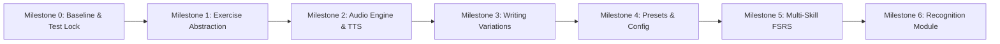

# Tsuzuri — Incremental Implementation Plan

**Document Reference**: `IMPLEMENTATION_PLAN.md`  
**Application**: Tsuzuri (綴り)  
**Target Specification**: Practice & Learning System Functional Specification v1.0  
**Date**: November 2026  
**Auditor**: Antigravity Technical Architecture Team  

---

## 1. Overview & Phased Roadmap

To maintain stability, avoid regressions, and uphold offline-first guarantees, the enhancement of Tsuzuri is partitioned into seven sequential milestones. Each milestone is independently testable and produces runnable software.

---

## 2. Milestone Details & File-by-File Changes

### Milestone 0: Baseline Stabilization & Test Lock
**Objective**: Lock in regression tests for all existing features before any code is modified.

- **Tasks**:
  1. Audit all 10 existing tests in `test/stroke_matcher_test.dart` and `test/db_and_fsrs_test.dart`.
  2. Verify that `flutter test` and `flutter analyze` exit with code 0.
  3. Create an automated regression test covering the existing *Meaning → Write Kanji* UI lifecycle (drawing 十 and observing FSRS rating update).
- **Files Modified / Created**:
  - `test/writing_flow_regression_test.dart` (New): Full widget test verifying `KanjiWritingCanvas` stroke acceptance and FSRS card creation.
- **Verification Criteria**:
  - 100% of existing tests pass.
  - Zero warnings or errors in `flutter analyze`.

---

### Milestone 1: Refine Exercise Abstraction
**Objective**: Introduce the domain entities for exercises and prompts without breaking the current UI.

- **Tasks**:
  1. Add `ExerciseActivity`, `ExerciseType`, `SkillType` to `lib/src/data/models.dart`.
  2. Define `ExercisePrompt`, `ExerciseAnswerMethod`, and `ExerciseDefinition`.
  3. Create `lib/src/domain/exercise_engine.dart` with `generateMeaningWritingExercise(KanjiCharacter kanji)`.
  4. Refactor `PracticeScreen` to accept an `ExerciseDefinition` instead of raw `PracticeQueueItem`.
- **Files Modified / Created**:
  - `lib/src/data/models.dart`: Add enums and sealed classes.
  - `lib/src/domain/exercise_engine.dart` (New): Factory for exercise definitions.
  - `lib/src/ui/screens/practice_screen.dart`: Consume `ExerciseDefinition`.
- **Verification Criteria**:
  - Meaning-based writing behaves identically to baseline.
  - Existing database records and FSRS updates remain 100% functional.

---

### Milestone 2: Audio Support & TTS Integration
**Objective**: Establish local speech synthesis, Japanese voice detection, and audio playback controls.

- **Tasks**:
  1. Add `flutter_tts: ^4.2.2` to `pubspec.yaml`.
  2. Implement `SpeechService` implementing `ISpeechService`.
  3. Add Japanese voice availability check on startup (`isJapaneseVoiceAvailable()`).
  4. Build `AudioPromptCard` widget with play/replay button, speed toggle (normal/slow), and autoplay rebuild guard.
  5. Implement *Audio → Write Kanji* in `ExerciseEngine`.
- **Files Modified / Created**:
  - `pubspec.yaml`: Add `flutter_tts`.
  - `lib/src/services/speech_service.dart` (New): Native TTS wrapper.
  - `lib/src/ui/widgets/audio_prompt_card.dart` (New): Audio prompt UI.
  - `lib/src/domain/exercise_engine.dart`: Add audio exercise generator.
- **Verification Criteria**:
  - Audio plays automatically when question loads (if autoplay ON).
  - Rebuilding the widget does **not** re-trigger audio.
  - Replay button works without limit.
  - If Japanese voice is missing, an informative banner appears and audio exercises are disabled gracefully.

---

### Milestone 3: Advanced Writing Variations (Copy & Guided Practice)
**Objective**: Extend `KanjiWritingCanvas` to support *Copy Practice* and *Guided Stroke-Order Practice*.

- **Tasks**:
  1. Update `KanjiWritingCanvas` and `_KanjiThreeLayerPainter`:
     - Add `bool showFullReference`: Renders faint reference character in background for copy mode.
     - Add `bool guidedMode`: Highlights next expected stroke, animates it, and locks canvas progression until drawn correctly.
  2. Implement *Kanji Reference → Copy Kanji* in `ExerciseEngine`.
  3. Implement *Guided Stroke-Order Practice* in `ExerciseEngine`.
  4. Divert completion callbacks for copy/guided practice away from FSRS recall updates and into diagnostic logs.
- **Files Modified / Created**:
  - `lib/src/ui/canvas/kanji_canvas.dart`: Add copy and guided painting logic.
  - `lib/src/domain/exercise_engine.dart`: Add copy & guided exercise definitions.
- **Verification Criteria**:
  - In copy mode, reference character is clearly visible on canvas.
  - In guided mode, only the active stroke can be drawn; following strokes are locked until the current stroke passes.
  - Completing a copy or guided exercise logs diagnostics but **does not** advance the user's FSRS writing recall card.

---

### Milestone 4: Exercise Configuration & Presets
**Objective**: Implement activity presets (*Beginner*, *Standard*, *Challenge*, *Listening Focus*, *Handwriting Focus*) and user configuration.

- **Tasks**:
  1. Create `ExerciseConfiguration` and `PracticePreset` models.
  2. Implement configuration validation and conflict resolution (e.g. disabling audio speed on non-audio exercises).
  3. Update `SettingsScreen` to allow choosing or customizing presets.
  4. Persist active preset ID and custom presets in `user_progress.db`.
- **Files Modified / Created**:
  - `lib/src/data/models.dart`: Add preset models.
  - `lib/src/data/user_db.dart`: Add `custom_presets` table and CRUD methods.
  - `lib/src/ui/screens/settings_screen.dart`: Add Preset selector UI.
  - `lib/src/providers/app_providers.dart`: Add `configurationProvider`.
- **Verification Criteria**:
  - Selecting "Beginner" automatically applies forgiving stroke matching, visual hints, and normal speed.
  - Selecting "Challenge" disables hints and applies strict matching.
  - Active session preserves its configuration snapshot even if global settings are changed mid-session.

---

### Milestone 5: Multi-Skill FSRS & Database Schema v3 Migration
**Objective**: Upgrade `user_progress.db` to isolate FSRS cards per skill.

- **Tasks**:
  1. Write Schema v3 migration in `UserDatabase._migrate()`:
     - Migrate `srs_cards.mode` to `srs_cards.skill_type`.
     - Create `writing_metrics` table for diagnostic practice.
  2. Update `FsrsSchedulerService` to accept `SkillType`.
  3. Update `ReviewQueueManager` to build queues per skill or mixed activities.
- **Files Modified / Created**:
  - `lib/src/data/user_db.dart`: Schema v3 migration script.
  - `lib/src/scheduling/fsrs_scheduler.dart`: Refactor to `SkillType`.
  - `lib/src/data/models.dart`: Update `UserCardProgress` model.
  - `test/db_and_fsrs_test.dart`: Add tests for Schema v3 migration.
- **Verification Criteria**:
  - Existing user progress from Schema v2 is migrated with zero data loss.
  - Separate cards exist for `writingRecall`, `meaningRecognition`, etc.
  - Copy and guided practice results write to `writing_metrics` without touching `srs_cards`.

---

### Milestone 6: Recognition Practice Module
**Objective**: Implement the four multiple-choice Recognition exercises.

- **Tasks**:
  1. Create `MultipleChoiceCard` and `KanjiTileGrid` widgets.
  2. Implement distractor generation algorithms in `ContentDatabase` (picking from the same school grade / JLPT level).
  3. Implement `RecognitionAnswerEvaluator` to validate selections and generate explanations.
  4. Wire up all four Recognition exercise types:
     - *Kanji → Meaning*
     - *Kanji → Reading*
     - *Meaning → Kanji*
     - *Audio → Recognition*
- **Files Modified / Created**:
  - `lib/src/ui/widgets/multiple_choice_card.dart` (New): Multiple-choice UI.
  - `lib/src/domain/recognition_evaluator.dart` (New): Recognition evaluation.
  - `lib/src/data/content_db.dart`: Add distractor query methods.
  - `lib/src/ui/screens/home_screen.dart`: Add Activity selector (Writing vs. Recognition).
- **Verification Criteria**:
  - Distractors are plausible and never contain a secondary valid meaning of the target Kanji.
  - Incorrect selections show immediate red feedback and reveal the correct answer.
  - Results update `meaningRecognition`, `readingRecognition`, or `listeningRecognition` FSRS cards.

---

## 3. Acceptance Criteria Mapping (FR-01 to FR-18)

| ID | Requirement | Milestone | Verification Method |
|---|---|---|---|
| **FR-01** | Activity selection | M4, M6 | User can toggle Writing or Recognition on Home screen. |
| **FR-02** | Exercise selection | M4 | Only valid exercise types for the active activity are selectable. |
| **FR-03** | Presets | M4 | Built-in presets (Beginner, Standard, Challenge) load their exact configurations. |
| **FR-04** | Custom configuration | M4 | User can modify settings and save as a custom preset. |
| **FR-05** | Meaning-based writing | M0, M1 | User writes kanji from meaning prompt; stroke matcher validates accuracy. |
| **FR-06** | Audio-based writing | M2 | Audio plays on question load; user writes kanji from spoken pronunciation. |
| **FR-07** | Copy practice | M3 | Reference kanji is visible on canvas; user copies it; results saved to metrics. |
| **FR-08** | Guided writing | M3 | Sequential stroke guidance with animated overlay; user follows stroke-by-stroke. |
| **FR-09** | Meaning recognition | M6 | 4-choice meaning selection with plausible distractors. |
| **FR-10** | Reading recognition | M6 | 4-choice kana reading selection in valid context. |
| **FR-11** | Meaning-to-Kanji | M6 | User selects correct kanji tile from meaning prompt. |
| **FR-12** | Audio recognition | M6 | User selects kanji tile matching spoken audio prompt. |
| **FR-13** | Evaluation | M1, M6 | Geometric matcher for writing; option matcher for recognition. |
| **FR-14** | Feedback | M0–M6 | Visual banner, hardware vibration, and system sounds for pass/fail. |
| **FR-15** | Progress | M5 | Attempts logged with timestamps, first attempt result, and metrics. |
| **FR-16** | FSRS | M5 | Independent skill cards receive separate schedules and intervals. |
| **FR-17** | Persistence | M0, M5 | Progress survives app restart, updates, and schema migrations. |
| **FR-18** | Offline operation | M0–M6 | Core learning functions operate 100% offline without network calls. |
