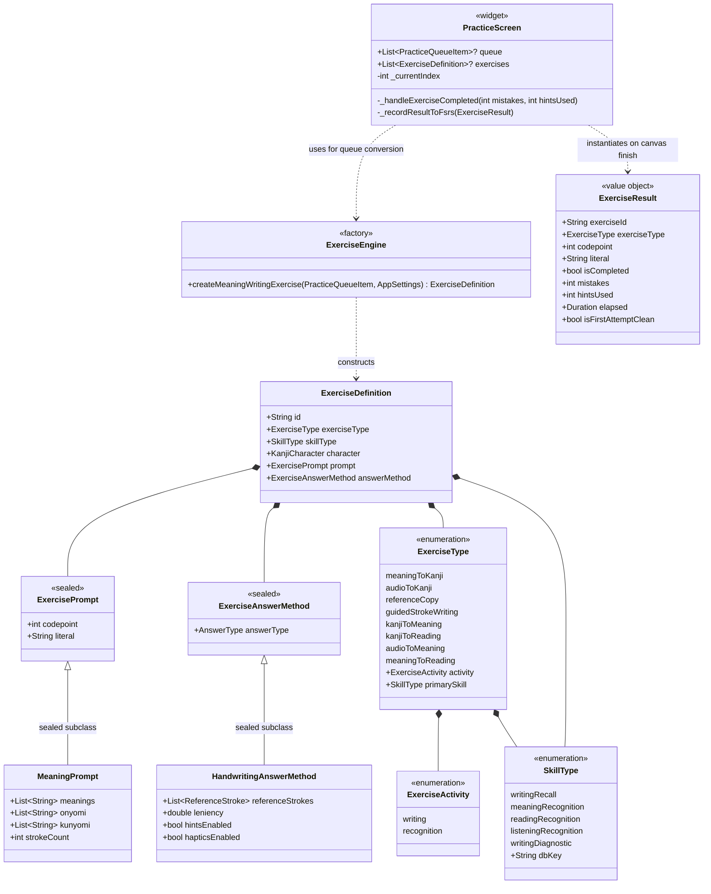
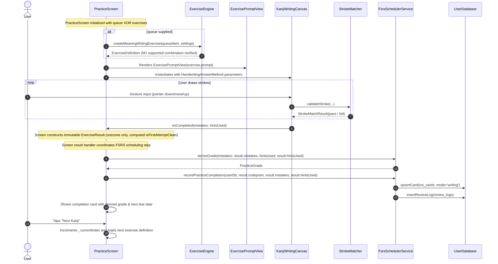

# Tsuzuri — Milestone 1: Exercise Abstraction Architecture Proposal

**Document Reference**: `docs/M1_ARCHITECTURE_PROPOSAL.md`  
**Application**: Tsuzuri (綴り) — Offline-first Japanese Kanji Learning Application  
**Milestone**: Milestone 1 (Exercise Abstraction — Phase 1: Design & Analysis)  
**Status**: Proposal / Design Baseline (Updated post Final Contract Clarifications)  
**Date**: November 2026  
**Author**: Antigravity Senior Flutter Architecture Team  

---

## 1. Executive Summary & Purpose

The objective of Milestone 1 is to introduce a **reusable exercise abstraction** that decouples question generation, prompt presentation, user input capture, and answer evaluation from the presentation screen ([`PracticeScreen`](file:///d:/offline_kanji_practice_v1/lib/src/ui/screens/practice_screen.dart)).

In Milestone 0, we established a strict test lock with 15 passing unit and integration tests. In Milestone 1, we design the minimal, extensible domain abstraction required to support the planned writing and recognition exercise variations, while **strictly limiting the initial implementation to the existing Meaning → Write Kanji exercise**.

### Strict Scope Boundary:
- **No changes to application code during this phase** (Phase 1 is design only).
- **Pure Dart Domain Layer**: All models under `lib/src/domain/exercises/` are 100% pure Dart, importing only `package:meta/meta.dart` and zero Flutter SDK libraries (`package:flutter/...`).
- **Zero changes to database schemas or FSRS card keys**: The writable SQLite table `srs_cards` remains keyed by `(codepoint, 'writing')`. `SkillType.writingRecall` maps explicitly to `'writing'`; any unsupported skill mapping fails with `UnsupportedError`.
- **Zero modification to the canvas drawing or stroke-matching algorithms**: [`KanjiWritingCanvas`](file:///d:/offline_kanji_practice_v1/lib/src/ui/canvas/kanji_canvas.dart) and [`StrokeMatcher`](file:///d:/offline_kanji_practice_v1/lib/src/matching/stroke_matcher.dart) (including [`ReferenceStroke`](file:///d:/offline_kanji_practice_v1/lib/src/matching/stroke_matcher.dart#L83) and [`Point2D`](file:///d:/offline_kanji_practice_v1/lib/src/matching/point2d.dart#L5)) are preserved as working building blocks.

---

## 2. Current Architecture & Coupling Analysis

### 2.1 Current Implementation State Trace
Before designing the abstraction, we traced the current execution lifecycle through the codebase:

1. **Kanji Selection**: In `HomeScreen`, `ref.watch(dailyQueueProvider)` calls `FsrsSchedulerService.buildDailyQueue()`. This returns `List<PracticeQueueItem>`, each containing a `KanjiCharacter` and an optional `UserCardProgress`. `HomeScreen` passes this list directly into the constructor: `PracticeScreen(queue: queue)`.
2. **State Ownership**: `_PracticeScreenState` owns all session progression: `_currentIndex`, `_characterCompleted`, `_derivedGrade`, `_nextDueDate`, `_lastMistakes`, and `_lastHints`.
3. **Screen-to-Canvas Communication**: `PracticeScreen` directly instantiates `KanjiWritingCanvas` with `kanji.strokes` (`List<ReferenceStroke>`), `settings.leniency`, `settings.hintsEnabled`, `settings.hapticsEnabled`, and the callback `onCompleted: _handleKanjiCompleted`.
4. **Handwriting Evaluation**: `KanjiWritingCanvas` tracks touch points via a `Listener` widget, normalizes points to the $109 \times 109$ KanjiVG coordinate space on pointer up, and calls `StrokeMatcher.validateStroke()`.
5. **Mistake & Hint Tracking**: Internal state in `KanjiWritingCanvasState` maintains `_mistakesOnCurrentKanji` and `_hintsUsedOnCurrentKanji`.
6. **Completion Firing**: When `_currentStrokeIndex == referenceStrokes.length`, `KanjiWritingCanvas` triggers `widget.onCompleted(mistakes, hintsUsed)`.
7. **FSRS Scheduling**: `_PracticeScreenState._handleKanjiCompleted` directly invokes `FsrsSchedulerService.deriveGrade()` and `scheduler.recordPracticeCompletion(userDb, codepoint, mistakes, hintsUsed)`. It hardcodes `mode: PracticeMode.writing`.
8. **Queue Advancement**: The user taps `"Next Kanji"` on the completion card, triggering `_advanceToNext()`, which increments `_currentIndex` and calls `setState()`.

### 2.2 Problems with Current Coupling
1. **Screen is Bound to a Single Prompt**: `PracticeScreen` hardcodes layout assumptions that every question is an English meaning with on'yomi/kun'yomi readings.
2. **Screen is Bound to a Single Answer Method**: `PracticeScreen` unconditionally builds `KanjiWritingCanvas`.
3. **Screen Directly Coordinates FSRS Scheduling**: The UI widget directly imports and drives `FsrsSchedulerService`, coupling presentation with persistence.
4. **Exercise Parameters are Scattered**: Leniency and hint settings are read directly from global `AppSettings` at the widget level, rather than being encapsulated within the exercise contract.

---

## 3. Proposed Architecture

The proposed architecture introduces a pure-Dart domain layer that separates an exercise into three immutable concerns:
1. **Prompt (`ExercisePrompt`)**: Sealed hierarchy representing what the user perceives. Specialized in M1 as `MeaningPrompt`.
2. **Answer Method (`ExerciseAnswerMethod`)**: Sealed hierarchy representing how the user responds. Specialized in M1 as `HandwritingAnswerMethod` (holding `List<ReferenceStroke>`).
3. **Exercise Definition (`ExerciseDefinition`)**: The unified contract bundling character, prompt, answer method, exercise type, and skill type. Explicitly validates the supported M1 combination (`meaningToKanji`, `writingRecall`, `MeaningPrompt`, `HandwritingAnswerMethod`).
4. **Exercise Result (`ExerciseResult`)**: Pure outcome data carrier capturing attempt metrics (`mistakes`, `hintsUsed`, `elapsed`, and computed `isFirstAttemptClean`). **It does not own FSRS grading or persistence logic.**

### 3.1 Component Responsibility Boundaries

| Component | Responsibility in M1 | Non-Responsibilities (Explicit Boundaries) |
|---|---|---|
| **`ExerciseEngine`** | Pure-Dart factory that constructs `ExerciseDefinition` instances from `PracticeQueueItem` (or `KanjiCharacter` + settings). | **Does not** manage session progression, own SQLite persistence, or execute FSRS scheduling. |
| **`ExercisePromptView`** | Composable presentation widget rendering `ExercisePrompt` variants (starting with `MeaningPrompt`). | Does not handle input or evaluation. |
| **`PracticeScreen`** | High-level presentation screen. Accepts either `queue` or `exercises` (strictly XOR). Renders prompt via `ExercisePromptView` and canvas via `KanjiWritingCanvas`. Advances queue index. | Does not construct prompt layout inline or implement geometric stroke matching. |
| **`ExerciseResult`** | Pure-Dart immutable value object recording the attempt outcome: `exerciseId`, `codepoint`, `literal`, `mistakes`, `hintsUsed`, `elapsed`, and computed `isFirstAttemptClean`. | **Does not** derive FSRS grades or interact with storage. |
| **`FsrsSchedulerService`** | Dedicated scheduling service. Retains existing `deriveGrade()` and `recordPracticeCompletion()` called via screen result handler. | Does not render UI or create exercises. |
| **`KanjiWritingCanvas`** | Captures drawing gestures, animates hints, and evaluates strokes via `StrokeMatcher`. | Unchanged. |
| **`StrokeMatcher`** | Pure-Dart geometric stroke evaluation using discrete Fréchet distance. | Unchanged. |
| **`ReferenceStroke`** | Immutable reference stroke model with pre-sampled points and arc length. Verified deeply immutable. | Unchanged. |

---

## 4. Class & Relationship Architecture Diagram

---

## 5. Exercise Lifecycle: From Creation to Completion

---

## 6. Detailed Architectural Decisions & Trade-Offs

### Decision 1: Pure Dart Domain Boundary
- **Context**: The domain layer represents learning abstractions independent of UI rendering engines.
- **Decision**: All models in `lib/src/domain/exercises/` are 100% pure Dart. They import only `package:meta/meta.dart` and pure Dart libraries (`dart:math`, etc.), with **zero imports of `package:flutter/...`**.
- **Rationale**: Guarantees fast, headless unit testing without Flutter test harnesses and prevents UI framework leaking into domain logic.

### Decision 2: Sealed Class Hierarchies for Prompts & Answer Methods
- **Context**: In Dart 3, `sealed class` restricts subclassing to the library where the sealed class is declared.
- **Decision**: `ExercisePrompt` and `ExerciseAnswerMethod` are declared as `sealed class`. Concrete variants within M1 (`MeaningPrompt`, `HandwritingAnswerMethod`) are declared as `final class`.
- **Rationale**: Enables exhaustive `switch` pattern matching in presentation and evaluation code without requiring fragile default cases or fallback paths.

### Decision 3: Complete Unicode Scalar Validation
- **Context**: Japanese Kanji codepoints must be valid Unicode scalar values. Values exceeding `0x10FFFF` or falling in the UTF-16 surrogate range (`0xD800–0xDFFF`) are malformed and can corrupt font rendering and database queries.
- **Decision**: All domain constructors accepting `codepoint` (`MeaningPrompt`, `ExerciseDefinition`, `ExerciseResult`) validate against the Unicode scalar range:
  $1 \le \text{codepoint} \le \text{0x10FFFF}$ and $\text{codepoint} \notin [\text{0xD800}, \text{0xDFFF}]$.
- **Rationale**: Eliminates corrupt character states at the domain boundary before they reach SQLite or UI painters.

### Decision 4: Strict M1 Combination Enforcement in `ExerciseDefinition`
- **Context**: Supporting arbitrary combinations of prompt and answer method in M1 risks untested, broken states.
- **Decision**: `ExerciseDefinition` explicitly validates that in M1:
  - `exerciseType == ExerciseType.meaningToKanji`
  - `activity == ExerciseActivity.writing`
  - `skillType == SkillType.writingRecall`
  - `prompt is MeaningPrompt`
  - `answerMethod is HandwritingAnswerMethod`
  Any other combination throws `ArgumentError`.
- **Rationale**: Keeps M1 strictly scoped to the existing working flow without creating a speculative, unverified general validation matrix.

### Decision 5: Computed `isFirstAttemptClean` on `ExerciseResult`
- **Context**: `isFirstAttemptClean` must remain consistent with `mistakes` and `hintsUsed`.
- **Decision**: `isFirstAttemptClean` is implemented strictly as a computed getter (`mistakes == 0 && hintsUsed == 0`) rather than an independent constructor argument.
- **Rationale**: Eliminates conflicting state representations (e.g. `mistakes: 3, isFirstAttemptClean: true`).

### Decision 6: Verification of `ReferenceStroke` Immutability
- **Context**: `HandwritingAnswerMethod` wraps its collection in `List.unmodifiable()`, but collection immutability requires that element objects are also immutable.
- **Decision**: Audited [`ReferenceStroke`](file:///d:/offline_kanji_practice_v1/lib/src/matching/stroke_matcher.dart#L83) and [`Point2D`](file:///d:/offline_kanji_practice_v1/lib/src/matching/point2d.dart#L5). Both classes declare only `final` fields and provide `const` constructors. Elements cannot be mutated after creation.
- **Action**: Preserved `ReferenceStroke` without modification; correctly reference `ReferenceStroke` across all domain contracts.
