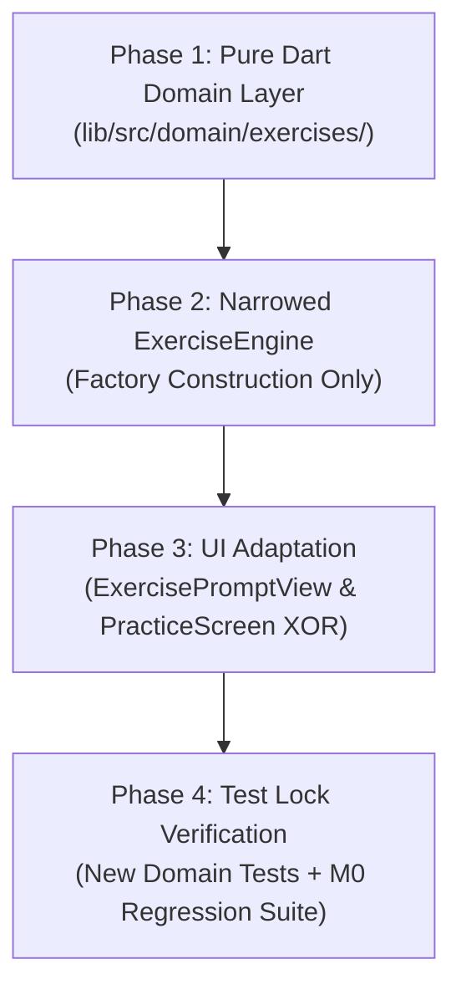

# Tsuzuri — Milestone 1: Implementation Plan

**Document Reference**: `docs/M1_IMPLEMENTATION_PLAN.md`  
**Application**: Tsuzuri (綴り) — Offline-first Japanese Kanji Learning Application  
**Milestone**: Milestone 1 (Exercise Abstraction — Phase 1: Design & Analysis)  
**Status**: Proposal / Implementation Blueprint (Updated post Final Contract Clarifications)  
**Date**: November 2026  
**Author**: Antigravity Senior Flutter Architecture Team  

---

## 1. Contract Clarifications Incorporated (Pre-Sub-problem 1)

In preparation for Sub-problem 1 implementation, the following six targeted contract clarifications have been incorporated into this plan and the domain model:

1. **Pure-Dart Domain Dependency Boundary**:
   - The domain layer under `lib/src/domain/exercises/` is strictly **pure Dart** with zero dependencies on `package:flutter/...`.
   - The only external package imported by domain models is `package:meta/meta.dart` (for `@immutable`).
   - Value equality is implemented using standard Dart utilities (`Object.hash`, pure-Dart collection comparison helper) without pulling in Flutter foundation or code generation tools.
2. **Consistent `sealed class` Declarations**:
   - `ExercisePrompt` and `ExerciseAnswerMethod` are declared as `sealed class`.
   - Concrete implementations within M1 (`MeaningPrompt` and `HandwritingAnswerMethod`) are declared as `final class`.
   - This ensures exhaustive `switch` pattern matching in UI and services while restricting external subclassing.
3. **Complete Unicode Scalar Range Validation**:
   - All models handling Kanji codepoints (`MeaningPrompt`, `ExerciseDefinition`, `ExerciseResult`) enforce Unicode scalar constraints:
     - $1 \le \text{codepoint} \le \text{0x10FFFF}$
     - $\text{codepoint} \notin [\text{0xD800}, \text{0xDFFF}]$ (surrogate code points are rejected)
4. **Strict M1 `ExerciseDefinition` Combination Enforcement**:
   - Rather than introducing an overly generalized validation matrix, `ExerciseDefinition` strictly enforces the single combination supported in Milestone 1:
     - `exerciseType == ExerciseType.meaningToKanji`
     - `activity == ExerciseActivity.writing`
     - `skillType == SkillType.writingRecall`
     - `prompt is MeaningPrompt`
     - `answerMethod is HandwritingAnswerMethod`
   - Any other combination throws `ArgumentError`.
5. **Computed `isFirstAttemptClean` on `ExerciseResult`**:
   - Removed `isFirstAttemptClean` from the constructor parameters.
   - Implemented strictly as a computed getter:
     ```dart
     bool get isFirstAttemptClean => mistakes == 0 && hintsUsed == 0;
     ```
   - Guarantees internal state consistency.
6. **Codebase Verification of `ReferenceStroke` Immutability**:
   - Audited [`ReferenceStroke`](file:///d:/offline_kanji_practice_v1/lib/src/matching/stroke_matcher.dart#L83) and [`Point2D`](file:///d:/offline_kanji_practice_v1/lib/src/matching/point2d.dart#L5).
   - Both classes have all `final` fields and provide `const` constructors.
   - Wrapped inside `List.unmodifiable(referenceStrokes)` in `HandwritingAnswerMethod`, reference strokes achieve full shallow and deep immutability. No code modifications to `ReferenceStroke` are required.

---

## 2. Implementation Strategy & Phasing

Implementation proceeds through four ordered, verifiable phases:



1. **Phase 1: Pure Dart Domain Layer**  
   Create the pure Dart models without Flutter or UI dependencies: standardized enums (`SkillType`, `ExerciseActivity`, `ExerciseType`, `AnswerType`), sealed prompt contracts (`ExercisePrompt`, `MeaningPrompt`), sealed answer method contracts (`ExerciseAnswerMethod`, `HandwritingAnswerMethod`), `ExerciseDefinition` (with M1 combination lock), and outcome-only `ExerciseResult`.
2. **Phase 2: Narrowed Exercise Engine**  
   Implement the pure factory logic to construct `ExerciseDefinition` from `PracticeQueueItem` (and `KanjiCharacter` + settings).
3. **Phase 3: UI Adaptation & Composition**  
   Extract prompt card rendering into `ExercisePromptView`. Refactor `PracticeScreen` to validate XOR constructor inputs and handle completion by converting `ExerciseResult` through the existing `FsrsSchedulerService`.
4. **Phase 4: Comprehensive Test Suite & Lock**  
   Add domain unit tests covering immutability, Unicode scalar validation, and factory mapping, then verify all 15 M0 regression tests pass with zero modification.

---

## 3. File Operations Matrix

| Path | Action | Description / Responsibility |
|---|---|---|
| [`lib/src/domain/exercises/exercise_types.dart`](file:///d:/offline_kanji_practice_v1/lib/src/domain/exercises/exercise_types.dart) | **Create** | Defines `ExerciseActivity`, `ExerciseType`, `SkillType` (with explicit SQLite mapping/error throwing), and `AnswerType`. Pure Dart. |
| [`lib/src/domain/exercises/exercise_prompt.dart`](file:///d:/offline_kanji_practice_v1/lib/src/domain/exercises/exercise_prompt.dart) | **Create** | Sealed `ExercisePrompt` and `MeaningPrompt` with unmodifiable collections, Unicode scalar validation. Pure Dart (`meta` only). |
| [`lib/src/domain/exercises/exercise_answer_method.dart`](file:///d:/offline_kanji_practice_v1/lib/src/domain/exercises/exercise_answer_method.dart) | **Create** | Sealed `ExerciseAnswerMethod` and `HandwritingAnswerMethod` wrapping `List<ReferenceStroke>`. Pure Dart (`meta` only). |
| [`lib/src/domain/exercises/exercise_definition.dart`](file:///d:/offline_kanji_practice_v1/lib/src/domain/exercises/exercise_definition.dart) | **Create** | Immutable aggregate with strict M1 combination validation (`meaningToKanji` + `writingRecall` + `MeaningPrompt` + `HandwritingAnswerMethod`). Pure Dart. |
| [`lib/src/domain/exercises/exercise_result.dart`](file:///d:/offline_kanji_practice_v1/lib/src/domain/exercises/exercise_result.dart) | **Create** | Pure outcome data carrier (mistakes, hints, elapsed, computed `isFirstAttemptClean`). Pure Dart. |
| [`lib/src/services/exercise_engine.dart`](file:///d:/offline_kanji_practice_v1/lib/src/services/exercise_engine.dart) | **Create** | Narrow pure factory constructing `ExerciseDefinition` from practice queue data. Pure Dart. |
| [`lib/src/ui/widgets/exercise_prompt_view.dart`](file:///d:/offline_kanji_practice_v1/lib/src/ui/widgets/exercise_prompt_view.dart) | **Create** | Presentation widget rendering prompt information (depends on Flutter). |
| [`lib/src/ui/screens/practice_screen.dart`](file:///d:/offline_kanji_practice_v1/lib/src/ui/screens/practice_screen.dart) | **Modify** | Add XOR constructor validation (`queue` XOR `exercises`), compose `ExercisePromptView`, and route completion through FSRS. |
| [`lib/src/ui/canvas/kanji_canvas.dart`](file:///d:/offline_kanji_practice_v1/lib/src/ui/canvas/kanji_canvas.dart) | **Untouched** | Preserved exactly as-is. |
| [`lib/src/matching/stroke_matcher.dart`](file:///d:/offline_kanji_practice_v1/lib/src/matching/stroke_matcher.dart) | **Untouched** | Preserved exactly as-is (`ReferenceStroke` verified immutable). |
| [`lib/src/data/db/user_database.dart`](file:///d:/offline_kanji_practice_v1/lib/src/data/db/user_database.dart) | **Untouched** | Schema v2 untouched; no migrations. |
| [`lib/src/services/fsrs_scheduler_service.dart`](file:///d:/offline_kanji_practice_v1/lib/src/services/fsrs_scheduler_service.dart) | **Untouched** | Scheduling formulas and card recording untouched. |
| [`test/exercise_domain_test.dart`](file:///d:/offline_kanji_practice_v1/test/exercise_domain_test.dart) | **Create** | Unit tests for domain models, Unicode scalar validation, unmodifiable collections, and factory logic. |
| [`test/writing_flow_regression_test.dart`](file:///d:/offline_kanji_practice_v1/test/writing_flow_regression_test.dart) | **Untouched** | Preserved 100% without modification. |

---

## 4. Existing Code: Reused vs Moved vs Replaced

### 4.1 Code to be Reused As-Is
- **`KanjiWritingCanvas` & `KanjiCanvasPainter`**: Kept completely untouched.
- **`StrokeMatcher`, `ReferenceStroke`, & `DiscreteFrechet`**: Zero changes. `ReferenceStroke` contains `final` fields and immutable `Point2D` points.
- **`FsrsSchedulerService`**: Reused for its FSRS calculation and persistence logic. Grade derivation continues to use existing `deriveGrade(mistakes: ..., hintsUsed: ...)`.

### 4.2 Code to be Moved / Refactored
- **Prompt Presentation Logic**:
  - Moved from `PracticeScreen.build()` lines 84–119 into [`ExercisePromptView`](file:///d:/offline_kanji_practice_v1/lib/src/ui/widgets/exercise_prompt_view.dart).
- **Result Packaging**:
  - Canvas completion callback packages raw mistakes and hints into an immutable `ExerciseResult`.

### 4.3 Code Replaced
- **Direct Queue Item Indexing in UI**:
  - Replaced with indexed lookup into `_exercises`, constructed either from direct injection or dynamically from `queue`.

---

## 5. State Management and Result Handling Strategy

1. **Local State Progression**:
   Queue advancement remains in `_PracticeScreenState` (`_currentIndex`, `_characterCompleted`, `_advanceToNext()`).
2. **Result Handling Boundary**:
   When `KanjiWritingCanvas.onCompleted(mistakes, hintsUsed)` fires:
   ```dart
   final result = ExerciseResult(
     exerciseId: currentExercise.id,
     exerciseType: currentExercise.exerciseType,
     codepoint: currentExercise.character.codepoint,
     literal: currentExercise.character.literal,
     isCompleted: true,
     mistakes: mistakes,
     hintsUsed: hintsUsed,
     elapsed: elapsedDuration,
   );

   // Handled in a separate step:
   _recordResultToFsrs(result);
   ```
3. **FSRS Integration Step**:
   ```dart
   void _recordResultToFsrs(ExerciseResult result) {
     final userDb = ref.read(userDatabaseProvider);
     final scheduler = ref.read(fsrsSchedulerProvider);

     final grade = FsrsSchedulerService.deriveGrade(
       mistakes: result.mistakes,
       hintsUsed: result.hintsUsed,
     );
     final updatedCard = scheduler.recordPracticeCompletion(
       userDb: userDb,
       codepoint: result.codepoint,
       mistakes: result.mistakes,
       hintsUsed: result.hintsUsed,
     );

     ref.read(progressRefreshTriggerProvider.notifier).state++;
     setState(() {
       _characterCompleted = true;
       _derivedGrade = grade;
       _nextDueDate = updatedCard.dueDate.toLocal();
       _lastMistakes = result.mistakes;
       _lastHints = result.hintsUsed;
     });
   }
   ```

---

## 6. Backward-Compatibility Strategy for Existing M0 Tests

1. **Strict XOR Constructor**:
   ```dart
   class PracticeScreen extends ConsumerStatefulWidget {
     final List<PracticeQueueItem>? queue;
     final List<ExerciseDefinition>? exercises;

     const PracticeScreen({
       super.key,
       this.queue,
       this.exercises,
     }) : assert(
            (queue != null) ^ (exercises != null),
            'Exactly one of queue or exercises must be provided',
          );
   ```
2. **Zero Test Churn**:
   All 5 baseline regression tests call `PracticeScreen(queue: queue)`. Because `queue != null` and `exercises == null`, the assertion succeeds and `PracticeScreen` transparently maps `queue` items via `ExerciseEngine.createMeaningWritingExercise`.
3. **Preserved Widget Hierarchy & Text**:
   `ExercisePromptView` produces the identical widget tree and strings (`kanji.meanings.join(', ')`, `On'yomi: ...`, `Kun'yomi: ...`, `${kanji.strokeCount} strokes`).

---

## 7. Testing Strategy for Milestone 1

### 7.1 New Unit Tests (`test/exercise_domain_test.dart`)
1. **Unicode Scalar Validation**:
   - Valid codepoint `0x5341` (十) passes.
   - Codepoints `<= 0` throw `ArgumentError`.
   - Surrogate codepoints `0xD800` through `0xDFFF` throw `ArgumentError`.
   - Codepoint `0x10FFFF` passes; `0x110000` throws `ArgumentError`.
2. **Immutability & Unmodifiable Lists**:
   - Modifying `meanings`, `onyomi`, or `referenceStrokes` after creation throws `UnsupportedError`.
3. **Explicit SkillType Mapping & Error Rejection**:
   - `SkillType.writingRecall.dbKey` returns `'writing'`.
   - All other 4 skills throw `UnsupportedError`.
4. **M1 Combination Validation**:
   - `ExerciseDefinition` with `ExerciseType.meaningToKanji` + `SkillType.writingRecall` + `MeaningPrompt` + `HandwritingAnswerMethod` succeeds.
   - Any mismatched combination throws `ArgumentError`.
5. **Computed `isFirstAttemptClean`**:
   - `mistakes: 0, hintsUsed: 0` $\to$ `isFirstAttemptClean == true`.
   - `mistakes: 1, hintsUsed: 0` $\to$ `isFirstAttemptClean == false`.
   - `mistakes: 0, hintsUsed: 1` $\to$ `isFirstAttemptClean == false`.
6. **Constructor XOR Validation**:
   - `PracticeScreen(queue: null, exercises: null)` throws `AssertionError`.
   - `PracticeScreen(queue: [...], exercises: [...])` throws `AssertionError`.
   - `PracticeScreen(queue: [...])` succeeds.
   - `PracticeScreen(exercises: [...])` succeeds.

### 7.2 Regression Lock Verification
Run:
```bash
flutter test
flutter analyze
```
All 15 existing tests + new unit tests must pass with exit code 0.

---

## 8. Milestone 1 Acceptance Criteria Checklist

- [ ] All models in `lib/src/domain/exercises/` are 100% pure Dart (`meta/meta.dart` only).
- [ ] `ExercisePrompt` and `ExerciseAnswerMethod` are declared as `sealed class`.
- [ ] Codepoints are validated as Unicode scalars ($1 \le c \le \text{0x10FFFF}$, excluding `0xD800..0xDFFF`).
- [ ] `ExerciseDefinition` strictly enforces the supported M1 combination.
- [ ] `ExerciseResult.isFirstAttemptClean` is a computed getter (`mistakes == 0 && hintsUsed == 0`).
- [ ] `SkillType.writingRecall` maps to `'writing'`; all other skill types fail explicitly with `UnsupportedError`.
- [ ] `PracticeScreen` constructor enforces `(queue != null) ^ (exercises != null)`.
- [ ] Collections are unmodifiable (`List.unmodifiable(...)`).
- [ ] All 15 existing tests in `test/` pass without modification.
- [ ] `flutter analyze` reports zero errors and zero warnings.
