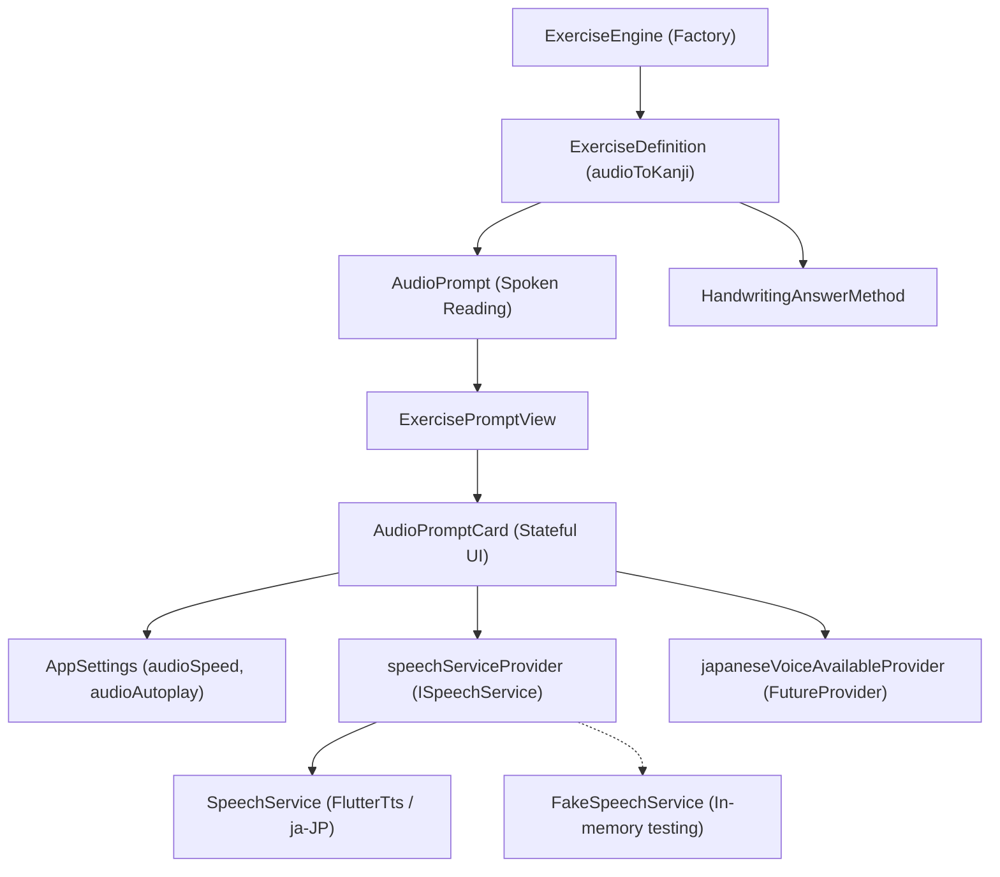

# Tsuzuri — Milestone 2: Audio Support & TTS Architecture Record

**Document Reference**: `docs/M2_AUDIO_ARCHITECTURE_AND_DECISIONS.md`  
**Application**: Tsuzuri (綴り) — Offline-first Japanese Kanji Learning Application  
**Milestone**: Milestone 2 (Audio Support & TTS Integration)  
**Status**: Implemented & Verified Baseline  
**Date**: November 2026  
**Author**: Antigravity Senior Flutter Architecture Team  

---

## 1. Executive Summary & Purpose

Milestone 2 introduced **spoken audio prompts** to Tsuzuri, powering our second core writing practice mode: **Audio → Write Kanji** (`audioToKanji`).

Because Tsuzuri is an offline-first learning system, speech synthesis is performed strictly using on-device Text-to-Speech (TTS) engines targeting Japanese (`ja-JP`). All 49 unit, widget, and integration tests pass cleanly with zero warnings in `flutter analyze`.

---

## 2. Architecture & Component Diagram



---

## 3. Key Architectural Decisions & Rationale

### Decision 1: Service Interface Abstraction for TTS (`ISpeechService`)
- **Context**: Calling platform channels like `FlutterTts` directly inside UI widgets couples the view layer to host operating system behavior, making headless unit and widget testing difficult and prone to `MissingPluginException`.
- **Decision**: All speech synthesis is isolated behind an abstract interface contract:
  ```dart
  abstract interface class ISpeechService {
    Future<bool> isJapaneseVoiceAvailable();
    Future<void> speakJapanese(String text, {double rate = 0.5});
    Future<void> stop();
  }
  ```
  A production implementation [`SpeechService`](file:///d:/offline_kanji_practice_v1/lib/src/services/speech_service.dart) wraps `FlutterTts`, while [`FakeSpeechService`](file:///d:/offline_kanji_practice_v1/lib/src/services/speech_service.dart) provides a deterministic, zero-dependency fake for automated CI testing.
- **Rationale**: Enables comprehensive widget testing of audio prompts and replay behaviors without needing real device audio hardware.

### Decision 2: Schema-Independent Key-Value Storage for Audio Preferences
- **Context**: The application needed to store `audioSpeed` (Normal vs. Slow) and `audioAutoplay` (on/off).
- **Decision**: Preferences are stored in the SQLite `user_settings` table via key-value records (`audio_speed`, `audio_autoplay`) in [`UserDatabase`](file:///d:/offline_kanji_practice_v1/lib/src/data/user_db.dart).
- **Rationale**: Introduces new user preferences without requiring database schema version bumps or table migrations.

### Decision 3: Sealed Prompt Hierarchy Extension (`AudioPrompt`)
- **Context**: The domain layer needed to model spoken questions with concealed meanings.
- **Decision**: Added `final class AudioPrompt extends ExercisePrompt` in [`lib/src/domain/exercises/exercise_prompt.dart`](file:///d:/offline_kanji_practice_v1/lib/src/domain/exercises/exercise_prompt.dart). Enforces valid Unicode scalars, non-empty spoken text, and unmodifiable hidden meanings.
- **Rationale**: Because `ExercisePrompt` is sealed, presentation widgets like [`ExercisePromptView`](file:///d:/offline_kanji_practice_v1/lib/src/ui/widgets/exercise_prompt_view.dart) use exhaustive pattern matching, guaranteeing compile-time safety across all prompt variants.

### Decision 4: Idempotent Post-Frame Autoplay Guard
- **Context**: In Flutter, stateful screens rebuild frequently (e.g. during drawing gestures on the canvas). Naive autoplay calls inside `initState` or `build` re-announce the reading repeatedly while the user is trying to draw.
- **Decision**: In [`AudioPromptCard`](file:///d:/offline_kanji_practice_v1/lib/src/ui/widgets/audio_prompt_card.dart), autoplay is dispatched via `WidgetsBinding.instance.addPostFrameCallback` and guarded by an instance field:
  ```dart
  if (settings.audioAutoplay && _lastAutoplayedExerciseId != widget.exerciseId) {
    _lastAutoplayedExerciseId = widget.exerciseId;
    _playAudio();
  }
  ```
- **Rationale**: Ensures spoken audio plays exactly once when a new exercise mounts, ignores subsequent widget rebuilds during canvas drawing, but transitions cleanly when the exercise ID advances.

### Decision 5: Non-Intrusive Offline Voice Availability Banner
- **Context**: Certain Android devices do not have offline Japanese voice packs pre-installed.
- **Decision**: `japaneseVoiceAvailableProvider` asynchronously checks `isJapaneseVoiceAvailable()`. If false, an amber warning banner appears explaining how to download Japanese voice data in system settings.
- **Rationale**: Fails gracefully without throwing uncaught exceptions or producing unintelligible phonetics.

---

## 4. Verification & Regression Lock

- **New Test Files Added**:
  - [`test/speech_service_test.dart`](file:///d:/offline_kanji_practice_v1/test/speech_service_test.dart) (Service abstraction, settings persistence, voice probing)
  - [`test/audio_prompt_test.dart`](file:///d:/offline_kanji_practice_v1/test/audio_prompt_test.dart) (Autoplay idempotency, replay counting, speed toggles, hidden meaning hint)
  - [`test/audio_writing_flow_test.dart`](file:///d:/offline_kanji_practice_v1/test/audio_writing_flow_test.dart) (Full end-to-end integration: Audio prompt presentation $\to$ canvas drawing $\to$ FSRS card update)
- **Status**: 49 tests passing, 0 analyzer issues.
