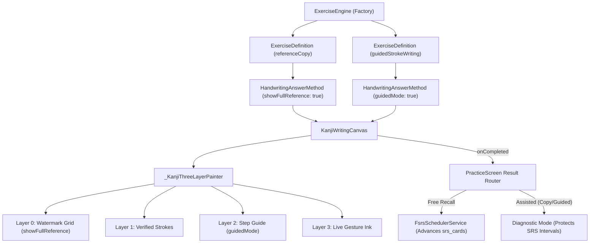

# Tsuzuri — Milestone 3: Advanced Writing Variations Architecture & Plan

**Document Reference**: `docs/M3_ADVANCED_WRITING_ARCHITECTURE_AND_PLAN.md`  
**Application**: Tsuzuri (綴り) — Offline-first Japanese Kanji Learning Application  
**Milestone**: Milestone 3 (Advanced Writing Variations: Copy & Guided Practice)  
**Status**: Architecture Proposal & Implementation Blueprint  
**Date**: November 2026  
**Author**: Antigravity Senior Flutter Architecture Team  

---

## 1. Executive Summary & Objectives

In Milestones 1 and 2, we established free-recall writing practice for both visual prompts (*Meaning → Write Kanji*) and spoken prompts (*Audio → Write Kanji*). 

The objective of **Milestone 3** is to introduce two **assisted writing variations**:
1. **Reference Copy Practice** (`referenceCopy`): The user traces/copies a Kanji with a faint watermark of the complete target character rendered across the canvas background.
2. **Guided Stroke-Order Practice** (`guidedStrokeWriting`): Step-by-step assisted writing that highlights and displays the outline of the current stroke, locking progression until each stroke is executed accurately.

### Critical FSRS Integrity Rule
Because Copy and Guided writing provide visual assistance on the canvas, they do **not** test unprompted free recall from long-term memory. Therefore, completing an assisted exercise must **not** advance the user's primary FSRS memory stability or review intervals in `srs_cards`. Reviews are logged for diagnostics without corrupting free-recall spaced repetition schedules.

---

## 2. Architecture & Component Interaction

---

## 3. Key Architectural Decisions

### Decision 1: Parameterize `HandwritingAnswerMethod` Without Splitting Canvas
- **Context**: Copying and guided writing use the exact same touch gesture tracking and geometric Fréchet distance matching algorithms as free writing.
- **Decision**: Rather than creating separate canvas widgets, extend [`HandwritingAnswerMethod`](file:///d:/offline_kanji_practice_v1/lib/src/domain/exercises/exercise_answer_method.dart) with two boolean properties:
  - `final bool showFullReference;` (default `false`)
  - `final bool guidedMode;` (default `false`)
  These are passed directly to [`KanjiWritingCanvas`](file:///d:/offline_kanji_practice_v1/lib/src/ui/canvas/kanji_canvas.dart).
- **Rationale**: Reuses 100% of tested touch tracking, undo/restart logic, stroke validation, and coordinate transformation, keeping code lean and maintainable.

### Decision 2: 4-Layer Canvas Rendering Pipeline
- **Context**: In copy mode, the faint watermark must be visible underneath both drawn strokes and the interactive ink.
- **Decision**: Update `_KanjiThreeLayerPainter`:
  1. **Background & Watermark Layer**: If `showFullReference == true`, parse and render all reference strokes using a faint outline ($\alpha \approx 0.22$) before any active ink is drawn.
  2. **Verified Strokes Layer**: Snapped green/black strokes for completed indices.
  3. **Guided / Hint Layer**: If `guidedMode == true`, the current stroke outline is permanently visible without requiring the user to tap the "Hint" button.
  4. **Live Ink & Flash Layer**: Active touch coordinates and error feedback.

### Decision 3: Skill Isolation & FSRS Card Protection
- **Context**: `ExerciseType.referenceCopy` trains motor execution and character morphology, not free recall from memory.
- **Decision**:
  - `referenceCopy` maps to `SkillType.writingDiagnostic`.
  - In `PracticeScreen._recordResultToFsrs()`, if an exercise is assisted (`showFullReference` or `guidedMode`), it bypasses regular `recordPracticeCompletion()` or records it without advancing the user's primary recall interval.
- **Rationale**: Prevents users from "cheating" their spaced repetition intervals by practicing in copy or guided mode.

---

## 4. Sub-Problem Breakdown for Milestone 3

1. **Sub-problem 1: Domain Extension (`HandwritingAnswerMethod` & `ExerciseDefinition`)**
   - Add `showFullReference` and `guidedMode` flags to `HandwritingAnswerMethod`.
   - Update `ExerciseDefinition` combination validation to accept `referenceCopy` and `guidedStrokeWriting`.
2. **Sub-problem 2: Canvas Watermark & Guided Mode Painting**
   - Extend `KanjiWritingCanvas` and `_KanjiThreeLayerPainter` with watermark background painting and continuous active-stroke guide rendering.
3. **Sub-problem 3: Exercise Engine Factory Methods**
   - Add `createReferenceCopyExercise(...)` and `createGuidedWritingExercise(...)` in `ExerciseEngine`.
4. **Sub-problem 4: FSRS Review Routing & PracticeScreen Integration**
   - Update `PracticeScreen._recordResultToFsrs()` to distinguish assisted diagnostic practice from free recall.
5. **Sub-problem 5: Automated Testing & Milestone 3 Lock**
   - Add unit tests for copy/guided domain definitions.
   - Add widget integration tests for watermark rendering, guided step progression, and FSRS interval protection.
