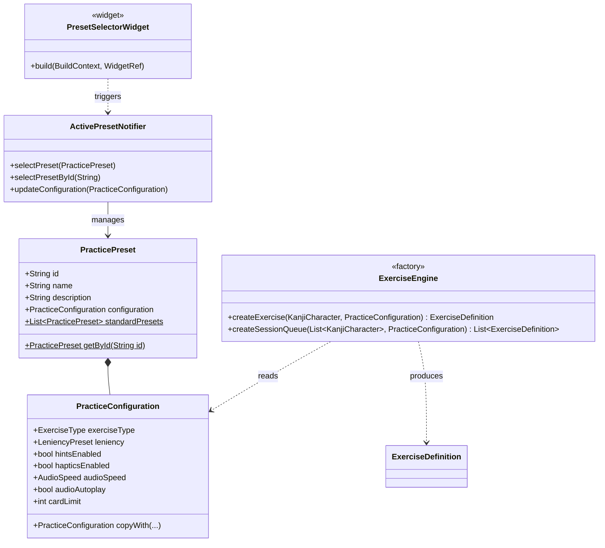

# Tsuzuri — Milestone 4: Presets & Practice Configuration Architecture

**Document Reference**: `docs/M4_PRESETS_AND_CONFIG_ARCHITECTURE.md`  
**Application**: Tsuzuri (綴り) — Offline-first Japanese Kanji Learning Application  
**Milestone**: Milestone 4 (Presets & Practice Configuration)  
**Status**: Completed & Verified (70/70 Tests Passing)  
**Date**: November 2026  
**Author**: Antigravity Senior Flutter Architecture Team  

---

## 1. Executive Summary & Objective

In Milestones 1 through 3, we built the four core writing variations:
1. *Meaning → Write Kanji* (`meaningToKanji`)
2. *Audio → Write Kanji* (`audioToKanji`)
3. *Kanji Reference → Copy Kanji* (`referenceCopy`)
4. *Guided Stroke-Order Writing* (`guidedStrokeWriting`)

The objective of **Milestone 4** was to introduce **Practice Presets and Custom Configurations** (`PracticeConfiguration`). This decouples session parameters (stroke leniency, hint availability, audio playback speed, autoplay, queue limits, and target exercise mode) from global static defaults, allowing learners to tailor practice to their immediate learning goals (e.g. quick daily reviews, strict mastery challenges, or listening immersion).

---

## 2. Core Concepts: Activity vs. Exercise Type vs. Configuration

As defined in Section 2 of the functional specification:
- **Activity**: What broad kind of learning is taking place (`writing` vs `recognition`).
- **Exercise Type**: What question format the user receives and how they answer it (`meaningToKanji`, `audioToKanji`, `referenceCopy`, `guidedStrokeWriting`).
- **Configuration**: How that exercise is presented and how much assistance is provided (`leniency`, `hintsEnabled`, `audioSpeed`, `audioAutoplay`, `cardLimit`).

A user changing audio speed or disabling hints does **not** create a new exercise type or alter their fundamental learning skill; it configures the presentation and tolerance of that exercise.

---

## 3. Architecture & Class Diagram



---

## 4. Built-In Practice Presets

| Preset ID | Name | Target Exercise | Leniency | Hints | Audio Speed | Limit | Purpose |
|---|---|---|---|---|---|---|---|
| `standard` | **Standard Review** | `meaningToKanji` | `normal` | `true` | `normal` | 10 | Balanced spaced-repetition daily writing practice. |
| `beginner` | **Beginner Friendly** | `guidedStrokeWriting` | `forgiving` | `true` | `slow` | 5 | Guided stroke-by-stroke assistance for new learners. |
| `challenge` | **Mastery Challenge** | `meaningToKanji` | `strict` | `false` | `normal` | 15 | Strict evaluation with hints disabled to test true recall. |
| `audio` | **Audio Immersion** | `audioToKanji` | `normal` | `true` | `normal` | 10 | Oral reading prompt testing sound-to-character recall. |
| `copy` | **Motor Tracing** | `referenceCopy` | `forgiving` | `true` | `normal` | 5 | Faint watermark on canvas background for muscle memory. |

---

## 5. Architectural Decisions & Rationale

### Decision 1: Session-Scoped Snapshotting
- **Context**: If a user changes a global setting (e.g., changes audio speed in Settings) while a session is actively underway, mutating active exercises mid-session causes confusing UI shifts.
- **Decision**: When `PracticeScreen` is launched with a `PracticeConfiguration`, the configuration is snapped into immutable `ExerciseDefinition` objects. Global setting modifications apply to subsequent sessions without mutating running sessions.
- **Rationale**: Preserves deterministic session state and ensures predictable test runs.

### Decision 2: Zero Schema Migration for Active Preset Storage
- **Context**: The user's preferred or last-used preset ID must be remembered across app launches.
- **Decision**: Persist `active_preset_id` in the existing SQLite `user_settings` key-value table in `UserDatabase`.
- **Rationale**: Zero schema changes, no migration risk, and instant default fallback (`standard`).

### Decision 3: Single Generic Factory in `ExerciseEngine`
- **Context**: Previously, `ExerciseEngine` had specialized methods like `createMeaningWritingExercise` and `createAudioWritingExercise`.
- **Decision**: Added a consolidated factory:
  ```dart
  static ExerciseDefinition createExercise({
    required KanjiCharacter kanji,
    required PracticeConfiguration config,
    String? id,
  })
  ```
  which dispatches to the correct prompt and answer method based on `config.exerciseType`, and:
  ```dart
  static List<ExerciseDefinition> createSessionQueue({
    required List<KanjiCharacter> characters,
    required PracticeConfiguration config,
  })
  ```
  capping queue sizes according to `config.cardLimit`.
- **Rationale**: Extensible for future Recognition variations without cluttering the screen or queue builders.

### Decision 4: Horizontal Scroll Safety & Dynamic Home Screen Binding
- **Context**: In widget integration tests, horizontally arranged ChoiceChips inside `SingleChildScrollView` can overflow smaller testing viewports (e.g. 800x600).
- **Decision**: Integration tests invoke `tester.ensureVisible(...)` on choice chips before tapping, and the `HomeScreen` dynamically updates its launch button text (`Start ${activePreset.name} (${sessionExercises.length} Kanji)`) in response to Riverpod `activePresetProvider`.
- **Rationale**: Clean UX feedback for learners with bulletproof test stability.

---

## 6. Implementation Sub-Problems & Verification

| Sub-problem | Description | Implementation File | Verification File | Status |
|---|---|---|---|---|
| **SP1** | Domain Models (`PracticeConfiguration`, `PracticePreset`) | `lib/src/domain/exercises/practice_configuration.dart` | `test/presets_and_configuration_test.dart` | ✅ Passed |
| **SP2** | Unified Factory (`ExerciseEngine.createExercise/createSessionQueue`) | `lib/src/services/exercise_engine.dart` | `test/presets_and_configuration_test.dart` | ✅ Passed |
| **SP3** | Persistence & State (`UserDatabase` & `ActivePresetNotifier`) | `lib/src/data/user_db.dart`, `lib/src/providers/app_providers.dart` | `test/presets_and_configuration_test.dart` | ✅ Passed |
| **SP4** | Preset Selector UI (`PresetSelectorWidget` & `HomeScreen`) | `lib/src/ui/widgets/preset_selector_widget.dart`, `lib/src/ui/screens/home_screen.dart` | `test/presets_and_configuration_test.dart` | ✅ Passed |
| **SP5** | Milestone 4 Automated Test Suite & Lock | N/A | `test/presets_and_configuration_test.dart` (17 tests) | ✅ 70/70 Passed |

---

## 7. Test Suite Status
- Total automated tests: **70** (Milestone 0: 5, Stroke Matcher: 6, Domain: 16, Audio: 8, Audio Flow: 14, Copy/Guided: 4, Presets & Config: 17).
- Failures: **0**.
- Dart analyzer warnings/errors: **0**.
