# Tsuzuri — Milestone 5: Recognition Exercises & Multi-Skill FSRS Architecture

**Document Reference**: `docs/M5_RECOGNITION_AND_MULTI_SKILL_ARCHITECTURE.md`  
**Application**: Tsuzuri (綴り) — Offline-first Japanese Kanji Learning Application  
**Milestone**: Milestone 5 (Recognition Exercises & Multi-Skill FSRS)  
**Status**: Completed & Verified (83/83 Tests Passing)  
**Date**: November 2026  
**Author**: Antigravity Senior Flutter Architecture Team  

---

## 1. Executive Summary & Objective

In Milestones 1 through 4, we built and unified the complete writing subsystem:
- Meaning-based writing (`meaningToKanji`)
- Audio-based writing (`audioToKanji`)
- Copy practice with watermark (`referenceCopy`)
- Guided stroke-order practice (`guidedStrokeWriting`)
- Preset & practice configuration engine (`PracticeConfiguration`, `PracticePreset`, `PresetSelectorWidget`)

The objective of **Milestone 5** was to implement the **Recognition Exercise System** and **Multi-Skill FSRS Persistence (Schema v3)**:
1. **Multi-Skill FSRS Persistence**: Upgraded `user_progress.db` to Schema v3 with `writing_metrics` and enabled independent card scheduling across `writingRecall`, `meaningRecognition`, `readingRecognition`, and `listeningRecognition`.
2. **Recognition Variations**:
   - *Kanji → Meaning* (`kanjiToMeaning`): Present Kanji, select English meaning.
   - *Kanji → Reading* (`kanjiToReading`): Present Kanji, select On'yomi / Kun'yomi kana reading.
   - *Meaning → Reading* (`meaningToReading`): Present meaning, select reading/Kanji.
   - *Audio → Meaning* (`audioToMeaning`): Present spoken Japanese pronunciation, select English meaning.
3. **Plausible Distractor Generator**: Offline algorithm selecting distractors from characters of the same school grade or JLPT level, filtering out synonyms or alternative valid readings of the target character.
4. **Interactive Multiple-Choice UI**: Dedicated, accessible `MultipleChoiceCard` widget with instant color-coded feedback and explanation banner.

---

## 2. Architecture & Class Diagram

```mermaid
classDiagram
    class SkillType {
        <<enumeration>>
        writingRecall
        meaningRecognition
        readingRecognition
        listeningRecognition
        writingDiagnostic
        +String dbKey
        +String v3DbKey
    }

    class ExercisePrompt {
        <<sealed>>
        +int codepoint
        +String literal
    }
    class KanjiPrompt {
        +int codepoint
        +String literal
        +int strokeCount
    }
    class MeaningPrompt {
        +List~String~ meanings
        +List~String~ onyomi
        +List~String~ kunyomi
    }
    class AudioPrompt {
        +String spokenText
        +List~String~ hiddenMeanings
    }

    class ExerciseAnswerMethod {
        <<sealed>>
    }
    class HandwritingAnswerMethod {
        +LeniencyPreset leniency
        +bool hintsEnabled
        +bool showFullReference
        +bool guidedMode
    }
    class MultipleChoiceAnswerMethod {
        +List~String~ options
        +int correctOptionIndex
        +String? explanation
    }

    class ContentDatabase {
        +generateMeaningDistractors(KanjiCharacter, count) List~String~
        +generateReadingDistractors(KanjiCharacter, count) List~String~
        +generateKanjiDistractors(KanjiCharacter, count) List~String~
    }

    class ExerciseEngine {
        +createKanjiToMeaningExercise(KanjiCharacter, ContentDatabase) ExerciseDefinition
        +createKanjiToReadingExercise(KanjiCharacter, ContentDatabase) ExerciseDefinition
        +createMeaningToReadingExercise(KanjiCharacter, ContentDatabase) ExerciseDefinition
        +createAudioToMeaningExercise(KanjiCharacter, ContentDatabase) ExerciseDefinition
    }

    class MultipleChoiceCard {
        <<widget>>
        +MultipleChoiceAnswerMethod answerMethod
        +void onOptionSelected(int, bool)
    }

    ExercisePrompt <|-- KanjiPrompt
    ExercisePrompt <|-- MeaningPrompt
    ExercisePrompt <|-- AudioPrompt
    ExerciseAnswerMethod <|-- HandwritingAnswerMethod
    ExerciseAnswerMethod <|-- MultipleChoiceAnswerMethod
    ExerciseEngine ..> ContentDatabase : queries distractors
    ExerciseEngine ..> MultipleChoiceAnswerMethod : builds
    MultipleChoiceCard ..> MultipleChoiceAnswerMethod : renders
```



---

## 3. Database Evolution: Schema v3

### 3.1 Migration Strategy
The `user_progress.db` schema version is bumped from 2 to 3.
- `srs_cards` table continues to use composite primary key `(codepoint, mode)`.
- Mode keys map directly to `SkillType.v3DbKey`:
  - `writingRecall` -> `'writing'` (preserves 100% of historical records)
  - `meaningRecognition` -> `'meaning_rec'`
  - `readingRecognition` -> `'reading_rec'`
  - `listeningRecognition` -> `'listening_rec'`
  - `writingDiagnostic` -> `'writing_diag'`
- Created table `writing_metrics` to record non-SRS stroke diagnostics:
  ```sql
  CREATE TABLE IF NOT EXISTS writing_metrics (
    id INTEGER PRIMARY KEY AUTOINCREMENT,
    codepoint INTEGER NOT NULL,
    exercise_type TEXT NOT NULL,
    shape_score REAL NOT NULL,
    order_errors INTEGER NOT NULL,
    retries INTEGER NOT NULL,
    duration_ms INTEGER NOT NULL,
    recorded_at TEXT NOT NULL
  );
  CREATE INDEX IF NOT EXISTS idx_writing_metrics_codepoint ON writing_metrics(codepoint);
  ```

---

## 4. Distractor Generation Algorithm

To maintain offline speed and pedagogical validity:
1. **Target Pool Filtering**:
   - Query candidate characters from `kanji_content.db` matching `grade == target.grade` or `jlpt_level == target.jlpt_level`.
   - If the subset is smaller than 4, expand pool to the entire kanji table.
2. **Pedagogical Safety Filter**:
   - Candidate meanings must not intersect with `target.meanings` (case-insensitive substring/equality match).
   - Candidate readings must not intersect with `target.onyomi` or `target.kunyomi`.
3. **Randomized Distribution**:
   - Select 3 distinct distractors.
   - Combine with correct option, shuffle using deterministic or local random seed, and track `correctOptionIndex`.

---

## 5. Architectural Decisions & Invariants

### Decision 1: Backward-Compatible `dbKey` & `v3DbKey` Invariant
- **Context**: In Schema v1 and v2, baseline tests asserted that non-writing skills throw `UnsupportedError` on `dbKey`.
- **Decision**: Maintained `dbKey` throwing `UnsupportedError` for non-writing skills in v2, while exposing `v3DbKey` which safely maps all skills (`'writing'`, `'meaning_rec'`, `'reading_rec'`, `'listening_rec'`).
- **Rationale**: 100% backward compatibility with all baseline regression tests while enabling multi-skill FSRS scheduling.

### Decision 2: Composable `KanjiPrompt`
- **Context**: Recognition exercises like *Kanji → Meaning* require displaying only the Kanji character without revealing its English meaning or readings.
- **Decision**: Added `final class KanjiPrompt extends ExercisePrompt` containing only `codepoint`, `literal`, and `strokeCount`.
- **Rationale**: Strict encapsulation prevents accidental data leakage in presentation widgets.

### Decision 3: Single Screen Adaptability in `PracticeScreen`
- **Context**: Should recognition exercises have a separate screen or share `PracticeScreen`?
- **Decision**: `PracticeScreen` inspects `exercise.answerMethod`. If `HandwritingAnswerMethod`, it renders `KanjiWritingCanvas`. If `MultipleChoiceAnswerMethod`, it renders `MultipleChoiceCard`.
- **Rationale**: Unifies session controls (progress bar, exit button, next exercise transition, FSRS completion recording) in a single well-tested lifecycle.

---

## 6. Implementation Sub-Problems & Verification

| Sub-problem | Description | Implementation File | Verification File | Status |
|---|---|---|---|---|
| **SP1** | Schema v3 Migration & Multi-Skill FSRS | `lib/src/data/user_db.dart`, `lib/src/domain/exercises/exercise_types.dart` | `test/recognition_exercises_test.dart` | ✅ Passed |
| **SP2** | Domain Abstractions & Distractors | `lib/src/domain/exercises/exercise_prompt.dart`, `lib/src/domain/exercises/exercise_answer_method.dart`, `lib/src/data/content_db.dart` | `test/recognition_exercises_test.dart` | ✅ Passed |
| **SP3** | ExerciseEngine Recognition Factories | `lib/src/services/exercise_engine.dart`, `lib/src/domain/exercises/exercise_definition.dart` | `test/recognition_exercises_test.dart` | ✅ Passed |
| **SP4** | MultipleChoiceCard & PracticeScreen Integration | `lib/src/ui/widgets/multiple_choice_card.dart`, `lib/src/ui/screens/practice_screen.dart` | `test/recognition_exercises_test.dart` | ✅ Passed |
| **SP5** | Milestone 5 Automated Test Suite & Lock | N/A | `test/recognition_exercises_test.dart` (13 tests) | ✅ 83/83 Passed |

---

## 7. Test Suite Status
- Total automated tests: **83** (Milestone 0: 5, Stroke Matcher: 6, Domain: 16, Audio: 8, Audio Flow: 14, Copy/Guided: 4, Presets & Config: 17, Recognition & Multi-Skill: 13).
- Failures: **0**.
- Dart analyzer warnings/errors: **0**.
