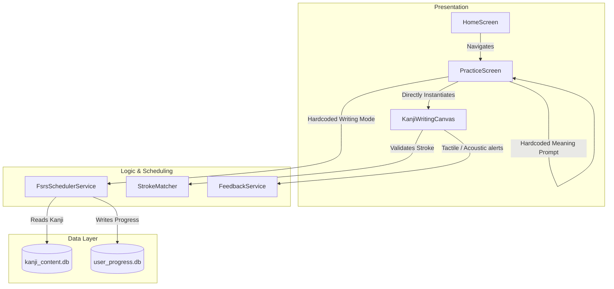
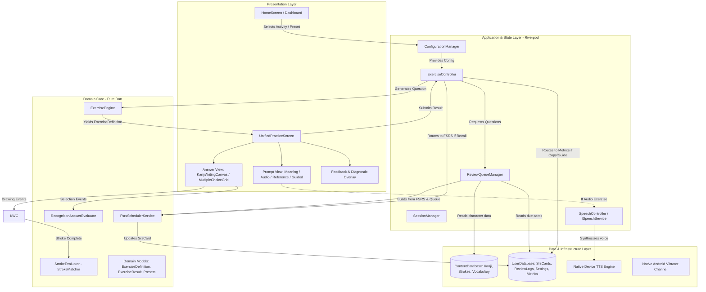
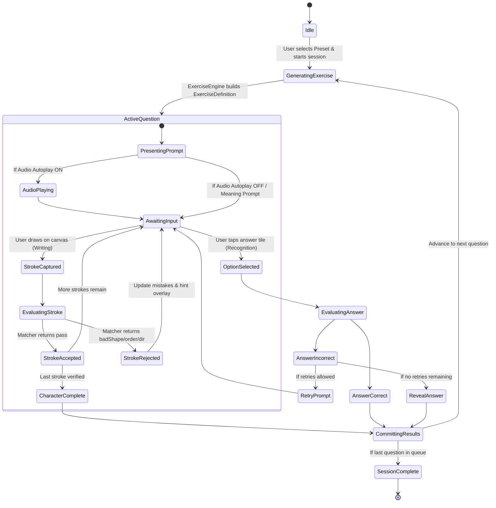

# Tsuzuri — Proposed Architecture & Component Evolution

**Document Reference**: `PROPOSED_ARCHITECTURE.md`  
**Application**: Tsuzuri (綴り)  
**Target Specification**: Practice & Learning System Functional Specification v1.0  
**Date**: November 2026  
**Auditor**: Antigravity Technical Architecture Team  

---

## 1. Architectural Goals & Design Principles

The proposed architecture addresses all weaknesses discovered in the audit while upholding the strict engineering constraints:

1. **Preserve What Works**:
   - The pure-Dart stroke matching engine ([`StrokeMatcher`](file:///d:/offline_kanji_practice_v1/lib/src/matching/stroke_matcher.dart), [`DiscreteFrechet`](file:///d:/offline_kanji_practice_v1/lib/src/matching/frechet.dart), [`StrokeGeometry`](file:///d:/offline_kanji_practice_v1/lib/src/matching/point2d.dart)) is retained without modification.
   - The 3-layer custom painter and gesture listener ([`KanjiWritingCanvas`](file:///d:/offline_kanji_practice_v1/lib/src/ui/canvas/kanji_canvas.dart)) remain the single reusable writing surface.
   - The dual-database architecture (`kanji_content.db` read-only, `user_progress.db` writable) remains strictly isolated.
   - Native Android hardware vibrator feedback ([`FeedbackService`](file:///d:/offline_kanji_practice_v1/lib/src/services/feedback_service.dart)) is preserved.

2. **Configuration-Driven Exercise Engine**:
   - Rather than creating unique screens for every combination, a single unified `ExerciseController` generates and manages questions based on an immutable `ExerciseConfiguration`.
   - Clear separation between **What is presented** (`ExercisePrompt`), **How the user responds** (`ExerciseAnswerWidget`), and **How the answer is scored** (`IAnswerEvaluator`).

3. **Multi-Skill Independent FSRS Tracking**:
   - `srs_cards` tracks separate cognitive skills (`meaningRecognition`, `readingRecognition`, `listeningRecognition`, `writingRecall`) without card collision.
   - Supporting practice modes (*Copy Practice*, *Guided Practice*) log diagnostics to `writing_metrics` without polluting the free-recall FSRS schedule.

4. **Offline First & Graceful Audio Fallback**:
   - Audio is handled by a lightweight `ISpeechService` wrapping device-native TTS.
   - If Japanese TTS is missing on the host device, the system detects this at startup, notifies the user, and gracefully disables audio exercises without crashing.

---

## 2. Current vs. Proposed Architecture Diagrams

### 2.1 Current Architecture (Tight Coupling)



### 2.2 Proposed Target Architecture (Decoupled & Extensible)



---

## 3. Component Responsibility Comparison Matrix

| Responsibility | Current Codebase Implementation | Proposed Target Implementation | Architectural Evolution |
|---|---|---|---|
| **Exercise Generation** | `PracticeScreen` extracts fields directly from `widget.queue[_currentIndex].kanji`. | `ExerciseEngine.generateExercise(kanji, config, type)` | **New abstraction**: Decouples exercise generation from UI rendering. Supports 4 writing and 4 recognition types. |
| **Session Control** | `_PracticeScreenState` manages index, completion flags, and navigation pops. | `SessionManager` / `ExerciseController` (Riverpod `AsyncNotifier`) | **Moved to state layer**: Controls question sequence, retry attempts, answer reveals, and timer metrics. |
| **Writing Canvas** | `KanjiWritingCanvas` with 3-layer CustomPainter. | `KanjiWritingCanvas` with 2 additional operational modes: `copyMode` and `guidedMode`. | **Preserved & extended**: Keeps the high-performance painter and gesture engine; adds reference display and step-locking. |
| **Stroke Evaluation** | `StrokeMatcher.validateStroke()` using discrete Fréchet distance. | Unchanged (`StrokeMatcher`). | **Preserved without modification**: Pure-Dart, zero-dependency mathematical evaluation. |
| **Recognition Evaluation** | Not implemented. | `RecognitionAnswerEvaluator.evaluate(selectedOption, expectedAnswer)` | **New lightweight domain evaluator**: Handles string/reading normalization and distractor validation. |
| **Audio Playback** | Missing completely. | `ISpeechService` wrapping device TTS (`flutter_tts`) with Japanese voice verification. | **New service**: Manages voice availability, autoplay protection, normal/slow playback speed, and stop on dispose. |
| **Configuration & Presets** | Flat `AppSettings` stored in `user_settings` table. | `PracticePreset` (Beginner, Standard, Challenge, etc.) + `ExerciseConfiguration`. | **Domain model upgrade**: Supports activity/exercise-specific toggles and user-saved presets. |
| **FSRS Scheduling** | `FsrsSchedulerService` updating `srs_cards` keyed by `(codepoint, 'writing')`. | `FsrsSchedulerService` updating `srs_cards` keyed by `(codepoint, skillType)`. | **Refined skill granularity**: Separates meaning, reading, listening, and writing recall into isolated schedules. |
| **Attempt Diagnostics** | `review_logs` table in `user_progress.db`. | Extended `review_logs` + `writing_metrics` for non-recall diagnostic practice (copy/guided). | **Enhanced logging**: Captures first attempt, response duration, shape score, and order errors. |

---

## 4. Detailed Data Flow & State Transitions

### 4.1 Exercise Session State Machine



### 4.2 FSRS Transaction Flow
When an exercise finishes, the `ExerciseController` executes an atomic database transaction:
1. **Skill Classification**: Checks whether the exercise type qualifies as a free-recall event (`MeaningToWrite`, `AudioToWrite`, `KanjiToMeaning`, `KanjiToReading`, `AudioToRecognition`).
2. **If Free-Recall**:
   - Derives FSRS rating (`again`, `hard`, `good`, `easy`) from initial attempt metrics.
   - Queries existing `srs_cards` for `(codepoint, skillType)`.
   - Calls `FsrsSchedulerService` to compute updated stability, difficulty, and next due date.
   - Upserts `srs_cards` and inserts into `review_logs`.
3. **If Diagnostic (Copy / Guided)**:
   - Does **not** touch `srs_cards`.
   - Inserts record into `writing_metrics` with `shape_score`, `order_errors`, and `retries`.
4. **Transaction Commit**: Guarantees that progress updates and review history never diverge.

---

## 5. Migration Strategy & Minimal-Change Architecture

To prevent regressions and avoid speculative rewrites, the transition will occur through a non-breaking incremental migration:

```
Step 1: Interface Extraction
  Introduce ExerciseDefinition, ExercisePrompt, ExerciseAnswer, and SkillType entities alongside existing models.

Step 2: Wrap Existing PracticeScreen
  Refactor PracticeScreen to consume an ExerciseDefinition without modifying the underlying KanjiWritingCanvas.

Step 3: Add Audio Service & Audio Prompt Card
  Introduce ISpeechService; plug AudioPromptCard into the unified exercise view.

Step 4: Extend KanjiWritingCanvas
  Add copyMode and guidedMode flags to KanjiWritingCanvas without modifying existing stroke validation paths.

Step 5: Database Schema v3 Migration
  Migrate user_progress.db to support SkillType and diagnostic metrics while preserving all existing progress.
```
