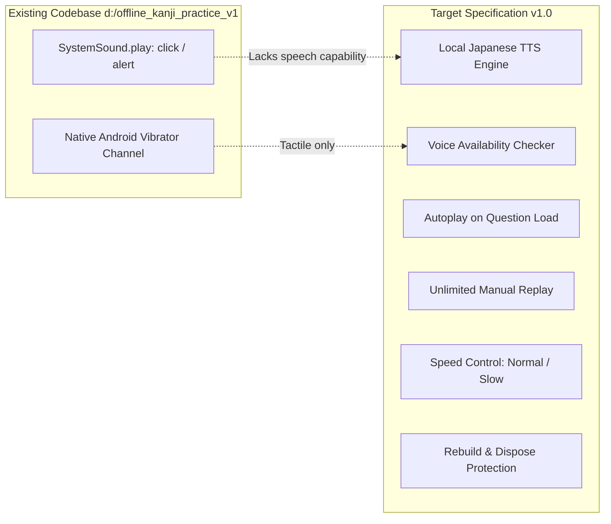

# Tsuzuri — Requirements Gap Analysis

**Document Reference**: `REQUIREMENTS_GAP_ANALYSIS.md`  
**Application**: Tsuzuri (綴り)  
**Target Specification**: Practice & Learning System Functional Specification v1.0  
**Date**: November 2026  
**Auditor**: Antigravity Technical Architecture Team  

---

## 1. Writing Exercises Gap Matrix

The target functional specification mandates four distinct writing exercise types. Below is a detailed gap analysis for each:

| Exercise Type | Existing Support | Reusable Components | Missing Components | Required Changes | Dependencies | Estimated Complexity |
|---|---|---|---|---|---|---|
| **1. Meaning → Write Kanji** | **Fully Implemented** (Baseline) | `KanjiWritingCanvas`, `StrokeMatcher`, `StrokeGeometry`, `DiscreteFrechet`, `KanjiCharacter`, `ContentDatabase` | Exercise abstraction model, first-attempt tracking. | Encapsulate existing `PracticeScreen` logic into an `ExercisePrompt` / `ExerciseAnswer` contract. | None (existing) | **Low** (Refactor to interface) |
| **2. Audio → Write Kanji** | **Missing** | `KanjiWritingCanvas`, `StrokeMatcher`, `FeedbackService` (tactile/click), `KanjiCharacter.onyomi/kunyomi` | Speech synthesis / TTS engine, Japanese voice detector, audio play/replay button widget, vocabulary/audio association tables in Content DB. | Add `ISpeechService`, add `AudioPromptCard` widget, link audio playback to exercise activation, map vocabulary prompt in database. | `flutter_tts` (or platform TTS), Content DB schema update | **Medium-High** |
| **3. Kanji Reference → Copy Kanji** | **Partially Supported in Canvas** (Hint layer has reference paths) | `KanjiWritingCanvas`, `KanjiSvgPathParser`, `StrokeMatcher`, 4-quadrant grid | Full-time static reference character toggle in `_KanjiThreeLayerPainter`, separate diagnostic logging (does not advance FSRS recall card). | Add `showFullReferenceCharacter: true` flag to `KanjiWritingCanvas`; bypass FSRS recall card updates when saving attempts. | None (internal to canvas & user DB) | **Low-Medium** |
| **4. Guided Stroke-Order Practice** | **Partially Supported in Canvas** (Animation engine already exists) | `_hintAnimController`, `nextStroke.svgPath`, `StrokeMatcher.validateStroke()`, stroke order error detection | Step-by-step stroke progression locking (must draw stroke $N$ with guide before unlocking stroke $N+1$), stroke animation auto-replay control, stroke numbers rendering. | Add `guidedMode: true` to `KanjiWritingCanvas`; lock canvas to current stroke with animated overlay until drawn correctly; log diagnostics without advancing FSRS recall card. | None (internal to canvas & user DB) | **Medium** |

---

## 2. Recognition Exercises Gap Matrix

The specification defines four initial Recognition exercise variations:

| Exercise Type | Target Behavior | Existing Support | Reusable Components | Missing Components | Estimated Complexity |
|---|---|---|---|---|---|
| **1. Kanji → Meaning** | Kanji prompt; 4 multiple-choice English meanings (1 correct, 3 plausible distractors). | **Missing** | `ContentDatabase` (kanji meanings and grades for distractor generation). | Multiple-choice question generator, distractor selector (from same grade/JLPT level), `MultipleChoiceCard` widget, `IAnswerEvaluator`. | **Medium** |
| **2. Kanji → Reading** | Kanji prompt in context; 4 multiple-choice kana readings (1 valid in-context reading, 3 distractors). | **Missing** | `ContentDatabase` (`onyomi`, `kunyomi` arrays). | Reading distractor generator, context-aware reading validator, multiple-choice UI. | **Medium** |
| **3. Meaning → Kanji** | English meaning prompt; 4 multiple-choice Kanji character tiles (1 correct, 3 distractors). | **Missing** | `ContentDatabase` (`literal`, `meanings`). | Meaning-to-Kanji distractor generator, Kanji tile button grid widget, recognition answer evaluator. | **Medium** |
| **4. Audio → Recognition** | Spoken audio prompt; 4 multiple-choice Kanji options. | **Missing** | `ContentDatabase` (kanji metadata). | Audio prompt player, TTS integration, multiple-choice evaluation. | **Medium-High** |

---

## 3. Audio Functionality Gap Analysis

An audit of the existing codebase confirms that **audio functionality is currently limited to basic system sound effects**.



### Detailed Feature Audit:
1. **TTS Integration**: **0% implemented**. No `flutter_tts` package or speech platform channel exists in `pubspec.yaml` or `android/`.
2. **Japanese Voice Availability Check**: **0% implemented**. No logic checks whether the device has a Japanese (`ja-JP`) TTS engine installed.
3. **Audio Playback Controls & Replay**: **0% implemented**. No audio player widgets exist.
4. **Playback Speed Control (Normal vs. Slow)**: **0% implemented**.
5. **Autoplay Rebuild Protection**: **0% implemented**. In Flutter, if audio playback is placed inside a widget `build()` method, every theme change or state update triggers repeated playback. A stateful or Riverpod-managed audio controller with an `exerciseId` playback guard is required.
6. **Single Exercise Playback vs. Audio Queue**:
   - The specification requires audio associated with the active exercise (pronounce on question load, replay on tap).
   - A sequential audio playlist across exercises is **not** required for v1. Creating an over-engineered background queue would violate minimal-change constraints. The immediate requirement is an `ISpeechService` scoped to the current exercise lifecycle.

---

## 4. Exercise Configuration & Preset System Gap

### Target vs. Current Configuration Model
The current codebase has a single, flat `AppSettings` class in [`lib/src/data/models.dart`](file:///d:/offline_kanji_practice_v1/lib/src/data/models.dart#L143-L172).

| Capability | Target Specification | Current Codebase | Gap Assessment |
|---|---|---|---|
| **Activity Separation** | Writing vs. Recognition | Single unified queue (`Daily Writing Queue`) | Missing activity routing |
| **Exercise Type Selection** | Meaning, Audio, Copy, Guided | Hardcoded Meaning → Write | Missing exercise routing |
| **Built-in Presets** | Beginner, Standard, Challenge, Listening Focus, Handwriting Focus | Hardcoded single flow with global leniency setting | Presets not modeled |
| **Custom Configuration** | Save custom presets to user database | Not supported | `custom_presets` table missing |
| **Conditional Setting Guards** | Audio speed hidden for non-audio; reference visibility hidden for non-copy | Not supported | Validation logic missing |

### Incompatible Combination Resolution Rules
The specification mandates that the configuration system must reject or resolve invalid settings:
- *Guided Practice + No Stroke Guide* $\rightarrow$ Invalid; guide must default to `stepByStep`.
- *Copy Practice + Reference Hidden* $\rightarrow$ Convert to recall or force reference visibility to ON.
- *Meaning Prompt + Audio Speed* $\rightarrow$ Audio speed control disabled/hidden.
- *Audio Prompt + Autoplay OFF* $\rightarrow$ Valid; requires user to tap manual play button before drawing.

---

## 5. Progress Tracking & FSRS Granularity Gap

### 5.1 Monolithic vs. Independent Skill Cards
In [`lib/src/data/user_db.dart`](file:///d:/offline_kanji_practice_v1/lib/src/data/user_db.dart#L47-L60), the FSRS card table is defined as:
```sql
CREATE TABLE srs_cards (
  codepoint INTEGER NOT NULL,
  mode TEXT NOT NULL,
  due_date TEXT NOT NULL,
  stability REAL NOT NULL,
  difficulty REAL NOT NULL,
  ...
  PRIMARY KEY (codepoint, mode)
);
```
Currently, `mode` is hardcoded to `PracticeMode.writing`.

According to Section 8.1 of the Functional Specification, Tsuzuri requires independent FSRS cards for separate cognitive skills:
1. `meaning_recognition` (Kanji $\rightarrow$ Meaning)
2. `reading_recognition` (Kanji $\rightarrow$ Reading)
3. `listening_recognition` (Audio $\rightarrow$ Recognition)
4. `writing_recall` (Meaning $\rightarrow$ Write, Audio $\rightarrow$ Write)

### 5.2 Diagnostic vs. Recall Practice Separation
**Crucial Requirement**: Copy practice (*Kanji Reference $\rightarrow$ Copy Kanji*) and *Guided Stroke-Order Practice* provide visual hints that bypass memory retrieval.
- **Current Behavior**: If a user runs a practice session today, any character completion updates the card in `srs_cards`.
- **Target Requirement**: Copy practice and Guided practice must write to a diagnostic table (`writing_metrics` or `practice_history`) to record shape and order accuracy, but **must never increase the stability or due date of the `writing_recall` FSRS card**.

### 5.3 Attempt Metrics Gap
The current `review_logs` table records:
- `rating` (1–4)
- `mistakes` (int)
- `hints_used` (int)
- `reviewed_at` (timestamp)

It is missing:
- `first_attempt_result`: Records whether the user drew the character correctly on their very first try without undo/restart.
- `response_duration_ms`: Time taken from question load to completion.
- `exercise_type`: The exact exercise variant that generated the attempt.
- `shape_score` and `order_errors`: Detailed handwriting diagnostics.

---

## 6. Priority & Readiness Ranking

Based on the audit, the gaps are prioritized by their architectural dependency:

| Priority | Area | Key Gap | Rationale |
|---|---|---|---|
| **P0** | **Exercise Abstraction** | Decouple `PracticeScreen` from Meaning $\rightarrow$ Write | Unblocks all other exercise variations without duplicating screens. |
| **P0** | **FSRS Skill Keys** | Migrate `srs_cards` to explicit `SkillType` | Prevents data corruption when new activities are introduced. |
| **P1** | **Copy & Guided Canvas Modes** | Add reference display & step-locking to canvas | Uses existing canvas CustomPainter with zero new dependencies. |
| **P1** | **Presets & Configuration** | Define `ExerciseConfiguration` & built-in presets | Allows users to pick Beginner / Standard / Challenge modes. |
| **P2** | **TTS & Audio Support** | Add `ISpeechService` and Japanese voice checker | Required for *Audio $\rightarrow$ Write* and *Audio $\rightarrow$ Recognition*. |
| **P2** | **Recognition Exercises** | Implement 4 multiple-choice exercise generators | Expands learning beyond handwriting. |
